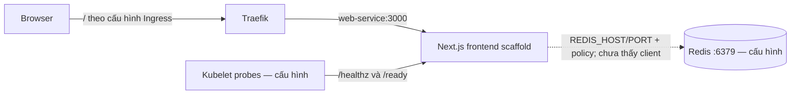
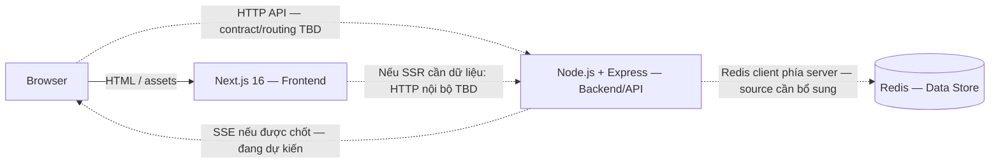

<p align="center">
  <a href="https://www.uit.edu.vn/" title="Trường Đại học Công nghệ Thông tin">
    
  </a>
</p>
<h1 align="center"><b>NT548.R12 - CÔNG NGHỆ DEVOPS VÀ ỨNG DỤNG</b></h1>
<p align="center"><b>ĐỒ ÁN MÔN HỌC: HỆ THỐNG DEVSECOPS & GITOPS TRÊN HẠ TẦNG KUBERNETES HYBRID</b></p>
<p align="center">
  <i>Repository: <code>devsecops-gitops-with-k8s</code></i>
</p>

<p align="center">
  
  
  
  
  
  
  
  
  
  
  
</p>

---

> **Đối chiếu tài liệu 04/11/2026 — version 0.2.0:** Hệ thống sử dụng **Next.js 16 (Frontend) + Node.js/Express (Backend/API) + Redis (data store)** theo xác nhận của người dùng. Snapshot source được kiểm tra: `2110eddec91bc3e34137c86fef693095c4afb677`. Hiện quan sát được scaffold Next, probes và cấu hình Redis; backend Express/integration chưa có bằng chứng trong snapshot này. Đây không phải kết luận backend không tồn tại ở local/repo khác. Trạng thái WBS là tiến độ được báo cáo, không thay thế bằng chứng test/deployment.
>
> Chi tiết: [Technology Stack](docs/technology-stack.md) · [System Architecture](docs/architecture.md) · [BA alignment](docs/ba-documentation-alignment.md).

## MỤC LỤC
- [1. Giới thiệu & Phân công nhóm](#1-giới-thiệu--phân-công-nhóm)
- [2. Tổng quan đề tài](#2-tổng-quan-đề-tài)
- [3. Kiến trúc hệ thống & Luồng hoạt động](#3-kiến-trúc-hệ-thống--luồng-hoạt-động)
- [4. Bảng tổng hợp công nghệ & Kỹ năng](#4-bảng-tổng-hợp-công-nghệ--kỹ-năng)
- [5. Cấu trúc Repository (Monorepo)](#5-cấu-trúc-repository-monorepo)
- [6. Kế hoạch triển khai 5 giai đoạn](#6-kế-hoạch-triển-khai-5-giai-đoạn-hoàn-thành-trước-05122026)
- [7. Kịch bản Demo kiểm chứng](#7-kịch-bản-demo-kiểm-chứng)
- [8. Tài liệu tham khảo](#8-tài-liệu-tham-khảo)

---

## 1. Giới thiệu & Phân công nhóm

### 1.1 Thông tin chung
- **Môn học:** NT548 - Công nghệ DevOps và Ứng dụng
- **Lớp:** NT548.R12 — HK1 2026-2027
- **Đơn vị:** Khoa Mạng máy tính và Truyền thông — Trường Đại học Công nghệ Thông tin, ĐHQG-HCM (UIT)
- **Đề tài:** Xây dựng hệ thống DevSecOps và GitOps tự động hóa triển khai, bảo mật và giám sát ứng dụng trên hạ tầng Kubernetes Hybrid
- **Repository:** `devsecops-gitops-with-k8s`

### 1.2 Thành viên nhóm & Phân chia công việc

| STT | MSSV | Họ và Tên | Vai trò chính | Nhiệm vụ đảm nhiệm | Môi trường làm việc |
|:---:|:---:|:---|:---|:---|:---|
| 1 | 23521367 | **Ngô Tiến Sỹ** | **Platform & DevOps Lead** | • Quản trị cụm K3s 3-node qua Tailscale Mesh Network, cấu hình Taints/Tolerations.<br>• Cấu hình Traefik Ingress và trỏ DNS Cloudflare.<br>• Khởi tạo ArgoCD GitOps quản lý 2 Application (App & Monitoring).<br>• Xây dựng GitHub Actions: Gitleaks $\rightarrow$ Trivy Scan $\rightarrow$ Build Docker $\rightarrow$ GHCR $\rightarrow$ Git tag.<br>• Soạn thảo Kubernetes Manifests chuẩn và triển khai kube-prometheus-stack. | Toàn quyền Server (VPS & K3s Cluster), GitHub Actions & Git |
| 2 | 23521222 | **Trần Hồng Phúc** | **Web Fullstack Dev** | • Phát triển Frontend Next.js 16 và Backend/API Node.js + Express, tích hợp Redis theo nghiệp vụ được chốt.<br>• Phân biệt probe Next hiện có `/healthz`, `/ready` với health/readiness backend và `/metrics` cần xác minh/bổ sung.<br>• Đóng gói theo từng component; Dockerfile hiện có là Next standalone, non-root UID 10001; source/runtime backend cần đối chiếu. | 100% Localhost & Git (`app/` frontend; đường dẫn backend cần xác minh) |
| 3 | 23520600 | **Điền Quốc Huy** | **QA & Observability Report** | • Thiết kế testcases và thực hiện kiểm thử tải Web (Autocannon / Postman).<br>• Khai thác Grafana Web UI, theo dõi metrics CPU, RAM, HTTP traffic.<br>• Soạn thảo Báo cáo Quan sát (Observability) và đánh giá hiệu năng hệ thống. | 100% Postman/Autocannon & Grafana Web UI |
| 4 | 22520804 | **Đặng Thế Long** | **Documentation & Demo Support** | • Hỗ trợ thực nghiệm và thu thập log/ảnh minh chứng 2 kịch bản demo.<br>• Chủ trì soạn thảo tài liệu Báo cáo đồ án môn học NT548 hoàn chỉnh.<br>• Thiết kế bộ Slide thuyết trình nghiệm thu đồ án. | 100% Google Docs / Word / Slide & Git |

---

## 2. Tổng quan đề tài

### 2.1 Tên chủ đề

> **Xây dựng hệ thống DevSecOps và GitOps tự động hóa triển khai, bảo mật và giám sát ứng dụng trên hạ tầng Kubernetes Hybrid.**

### 2.2 Nội dung thực hiện (5 nội dung cốt lõi)

1. **Quản trị hạ tầng mạng & cụm Kubernetes Hybrid:**  
   Cấu hình DNS Cloudflare và SSL/TLS trỏ tên miền về VPS Public IP. Vận hành cụm K3s 3-node (1 Control Plane VPS 6GB RAM + 2 Worker nodes on-premises 2x 8GB = 16GB, tổng 22GB RAM) kết nối bảo mật qua mạng Tailscale Overlay.
2. **Thiết lập đường ống CI & DevSecOps tự động hóa:**  
   Xây dựng GitHub Actions tích hợp rà soát bí mật mã nguồn (Gitleaks), quét lỗ hổng thư viện và container image (Trivy), tự động đóng gói image theo runtime từng component (frontend hiện cấu hình Node 26; runtime backend cần xác minh) với user non-root UID 10001 (`USER 10001`), lưu trữ an toàn trên GitHub Container Registry (GHCR) và tự động cập nhật tag GitOps.
3. **Triển khai Continuous Deployment (CD) theo mô hình GitOps:**  
   Cấu hình ArgoCD tự động đồng bộ cấu hình ứng dụng từ Git repository xuống Kubernetes (source hiện trỏ Kustomize `k8s-manifests/`), kích hoạt cơ chế tự phục hồi (Self-healing: `prune: true`, `selfHeal: true`) và hỗ trợ Rollback an toàn qua `git revert`.
4. **Bảo mật Kubernetes (Runtime Security & NetworkPolicy):**  
   Áp dụng Pod SecurityContext (`runAsNonRoot: true`, `runAsUser: 10001`, `allowPrivilegeEscalation: false`, `capabilities: {drop: [ALL]}`). Cấu hình NetworkPolicy giới hạn truy cập Redis TCP/6379. Root Kustomize hiện đưa Web và Redis vào cùng namespace `production-app`; policy cho phép Pod `app: web` cùng namespace. `database/` là thư mục nguồn, không phải bằng chứng namespace riêng; kết nối backend và hiệu lực live cần kiểm chứng.
5. **Hệ thống Giám sát & Báo cáo Quan sát (Observability):**  
   Triển khai `kube-prometheus-stack` thông qua Helm/ArgoCD (`ServerSideApply=true`, vô hiệu hóa các exporter không dùng của K3s), dự kiến ứng dụng tích hợp endpoint `/metrics` (ví dụ `prom-client` cho Node.js; chưa thấy source tích hợp), khai thác giao diện Grafana Web UI để theo dõi tài nguyên và lập Báo cáo Quan sát & Đánh giá hiệu năng hệ thống.

### 2.3 Kết quả dự kiến đạt được

1. Hệ thống DNS Cloudflare và cụm Kubernetes Hybrid 3-node vận hành ổn định qua Tailscale, phân tách rõ vai trò Control Plane và Worker nodes.
2. Pipeline CI/DevSecOps vận hành tự động, chặn kịp thời mọi commit làm rò rỉ secret (Gitleaks) hoặc chứa lỗ hổng CVE nghiêm trọng có bản vá (Trivy).
3. Ứng dụng gồm Frontend Next.js 16, Backend/API Node.js + Express và Redis được triển khai tự động (Zero-touch deployment) qua ArgoCD với khả năng tự phục hồi trạng thái tức thì.
4. Container ứng dụng vận hành an toàn ở chế độ non-root với đầy đủ SecurityContext bảo vệ.
5. Dashboard Grafana hiển thị trực quan thông số CPU, RAM, trạng thái Pod và HTTP metrics ứng dụng thời gian thực; có tài liệu Báo cáo Quan sát & Đo kiểm tải chi tiết.

---

## 3. Kiến trúc hệ thống & Luồng hoạt động

### 3.1 Hiện trạng source và cấu hình

Nguồn kiểm tra là commit trong phần đối chiếu phía trên; các mũi tên sau mô tả cấu hình/source, không xác nhận hệ thống đang chạy live.



- Source Next.js 16/React và hai route probe có trong `app/`; `page.tsx` vẫn là starter.
- `app/Dockerfile` build Next standalone, dùng tag `node:26.13.0-alpine3.23`; `server.js` là output Next, không phải bằng chứng Express entry point.
- Chưa tìm thấy package/source Express hoặc Redis client trong snapshot; chưa kiểm chứng API nghiệp vụ, visit counter, `/metrics`, Three.js hoặc SSE.
- Root Kustomize dùng namespace `production-app` cho Web/Redis/policy; `database/` là thư mục.
- `/ready` hiện trả HTTP 200 mà chưa kiểm tra Redis, nên không đại diện E2E readiness.

### 3.2 Phân vai và luồng tích hợp đã xác nhận

Mô hình công nghệ của hệ thống gồm cả Next.js, Express và Redis. Nét đứt thể hiện các đường tích hợp chưa có bằng chứng source/test trong snapshot; route, port backend và cách đóng gói chưa được tự quyết định.



Frontend render UI và tiêu thụ API; backend xử lý validation/rules, phản hồi/lỗi và data access; Redis lưu dữ liệu theo Data contract cần chốt. Browser không truy cập Redis. Node.js là runtime cho các process liên quan, không đồng nghĩa framework Express. Hướng Laravel dài hạn thay backend/API, giữ Next là consumer.

### 3.3 Delivery, operations và dependencies

Workflow hiện scan/build context `app/`, publish image và update Kustomize tag; ArgoCD trỏ `k8s-manifests/`. Điều này là cấu hình delivery cho workload hiện tại, chưa chứng minh có pipeline/image backend riêng. Không tự thêm Service/Ingress/namespace/pipeline Express.

Tích hợp cần source backend và contract trước khi xác nhận routing, auth, Redis access, readiness theo dependency và metrics của từng component. Prometheus/Grafana có cấu hình; HTTP metrics ứng dụng chưa có bằng chứng handler/scrape. WBS giữ tiến độ báo cáo và bổ sung evidence/dependency gates.

Canonical chi tiết và source register: [System Architecture](docs/architecture.md); stack/status: [Technology Stack](docs/technology-stack.md); tác động BRD/FRD/API/Data/Migration: [BA alignment](docs/ba-documentation-alignment.md).

---

## 4. Bảng tổng hợp công nghệ & Kỹ năng

### 4.1 Application stack

| Thành phần | Vai trò | Trạng thái bằng chứng |
|---|---|---|
| Next.js 16 / React | Frontend rendering, routing, UI và API consumer | Có scaffold/source; UI nghiệp vụ chưa xác minh hoàn thiện |
| Node.js + Express | Runtime + framework Backend/API, rules và Redis data access | Vai trò do người dùng xác nhận; source/backend runtime chưa thấy trong snapshot |
| Redis | Data store phía server | Có manifests/config; client/keys/TTL/live integration chưa xác minh |
| Three.js / SSE | UI 3D / realtime nếu được chốt | Đang dự kiến; chưa thấy source tích hợp |

Phiên bản và dependencies theo component được quản lý tại [Technology Stack](docs/technology-stack.md); không áp tag Node frontend cho backend.

### 4.2 Infrastructure và kỹ năng

| Thành phần | Công cụ sử dụng | Kỹ năng đạt được / Trọng tâm chứng chỉ |
|:---|:---|:---|
| **Networking & DNS** | Cloudflare DNS, Tailscale Mesh VPN | Quản trị định tuyến tên miền, SSL/TLS, kết nối mạng Overlay an toàn giữa VPS và Worker nodes on-premises. |
| **Cluster Setup** | Linux (Ubuntu), K3s, Tailscale Mesh | **Trọng tâm CKA**: Cấu hình mạng Overlay, Taints/Tolerations, phân bổ tải đa node. |
| **CI & DevSecOps** | GitHub Actions, Gitleaks, Trivy, GHCR | **Nền tảng CKS & DevSecOps**: Secret scanning, Quét CVE mã nguồn và Container image, Container Hardening non-root. |
| **CD & GitOps** | ArgoCD | **Trọng tâm CKAD & GitOps**: Declarative Delivery, Auto-sync, Self-healing & Rollback. |
| **K8s Security** | Traefik Ingress, Kubernetes NetworkPolicy, SecurityContext | **Trọng tâm CKAD & CKS**: Định tuyến Ingress HTTPS, SecurityContext non-root, cô lập mạng tầng database. |
| **Observability** | Prometheus, Grafana (Helm `kube-prometheus-stack`) | Giám sát hạ tầng; metrics ứng dụng cần endpoint/scrape evidence (`prom-client` đang dự kiến), trực quan hóa chỉ số qua Grafana Web UI và lập Báo cáo Quan sát. |

---

## 5. Cấu trúc Repository (Monorepo)

```text
devsecops-gitops-with-k8s/
├── README.md                           # Tài liệu tổng quan dự án
├── WBS.md                              # Cấu trúc phân rã công việc (WBS) & timeline chi tiết (dùng cho Sheet)
├── LOG.md                              # Nhật ký nguồn; cần đối chiếu evidence khi kết luận trạng thái
├── docs/                               # Tài liệu đối chiếu stack/architecture/BA
│   ├── technology-stack.md
│   ├── architecture.md
│   └── ba-documentation-alignment.md
├── argocd/                             # Cấu hình Application CRD & Values cho ArgoCD (Sỹ phụ trách)
│   ├── app.yaml                        # Application triển khai GitOps Kustomize cho Web App & Redis
│   ├── monitoring.yaml                 # Application triển khai kube-prometheus-stack (Multiple Sources)
│   └── values.yaml                     # Helm values tùy biến ArgoCD (Ingress Traefik, Worker Affinity)
├── app/                                # Mã nguồn ứng dụng Next.js 16 App Router (Phúc phụ trách)
│   ├── src/app/                        # Next.js App Router (kèm API probe /healthz, /ready)
│   ├── package.json                    # Khai báo pnpm, Next.js 16, React 19, Tailwind CSS v4
│   ├── next.config.ts                  # Cấu hình output: standalone
│   └── Dockerfile                      # Multi-stage build (node:26.13.0-alpine3.23, pnpm, non-root UID 10001)
├── k8s-manifests/                      # Thư mục GitOps Kustomize quản lý ứng dụng (Sỹ phụ trách)
│   ├── kustomization.yaml              # Root Kustomization: áp namespace production-app lên toàn bộ resources
│   ├── base/                           # Tài nguyên Web App
│   │   ├── kustomization.yaml          # Quản lý Image tag, ConfigMap, Deployment, Service, Ingress
│   │   ├── deployment.yaml             # Web App Deployment (SecurityContext non-root UID 10001, probes)
│   │   ├── service.yaml                # Web App Service ClusterIP cổng 3000
│   │   ├── configmap.yaml              # Biến môi trường (REDIS_HOST: redis-service, PORT: 3000)
│   │   └── ingress.yaml                # Traefik Ingress định tuyến nt548.helios.id.vn
│   ├── database/                       # Tài nguyên Database
│   │   ├── kustomization.yaml
│   │   └── redis.yaml                  # Redis Deployment (LTS 8.2.11-alpine3.22, probes) & Service
│   └── security/                       # Tài nguyên an ninh
│       ├── kustomization.yaml
│       └── network-policy.yaml         # Policy ingress Redis từ app: web cùng namespace; live chưa test
├── k3s-config/                         # Cấu hình K3s Server & Agent nodes qua Tailscale
│   ├── config.server-01.yaml           # Cấu hình Control Plane (disable traefik, flannel tailscale0)
│   ├── config.agent-01.yaml            # Cấu hình Worker 01
│   └── config.agent-02.yaml            # Cấu hình Worker 02
├── monitoring/                         # Cấu hình giám sát (Sỹ setup, Huy khai thác)
│   └── values.yaml                     # Values cho kube-prometheus-stack (tắt component K3s không dùng)
├── traefik/                            # Cấu hình Traefik Ingress Controller qua Helm (Sỹ phụ trách)
│   ├── values.yaml                     # Values Helm Traefik: HostPort 80/443, Metrics 9100, ClusterIP
│   ├── tlsstore.yaml                   # TLSStore default nạp Cloudflare Origin CA cert
│   └── cloudflare-origin-tls-secret.yaml # Secret TLS lưu cert & key
├── scripts/                            # Kịch bản kiểm chứng tự động (Long & Sỹ phụ trách)
│   └── demo.sh                         # Script hướng dẫn thuyết trình 3 kịch bản demo (Read-only)
└── .github/workflows/                  # Đường ống CI/DevSecOps (Sỹ phụ trách)
    └── ci-pipe.yml                     # Workflow: Gitleaks + Trivy + Build & Push GHCR + Kustomize Tag update
```

---

## 6. Kế hoạch triển khai 5 giai đoạn (Hoàn thành trước 05/12/2026)

| Giai đoạn | Thời gian | Mục tiêu hoàn thành (Definition of Done) | Người phụ trách chính |
|:---|:---:|:---|:---|
| **Phase 1: Khởi động** | Trước 01/11 | Chốt đề tài & phạm vi tinh giản; thống nhất tech stack; phân định trách nhiệm các thành viên. | Cả nhóm (Sỹ chủ trì) |
| **Phase 2: Thiết kế & Setup** | 01/11 - 05/11 | Lập WBS đưa lên Sheet; vẽ topology K3s Hybrid & luồng GitOps; thống nhất contract Frontend Next/browser <-> Express và Data contract Express <-> Redis; tách probe K8s khỏi business API. | Sỹ, Long, Phúc |
| **Phase 3: Triển khai & Tích hợp** | 06/11 - 20/11 | Dựng K3s 3-node qua Tailscale; trỏ DNS Cloudflare; tích hợp Frontend Next.js + Backend/API Express + Redis theo contract; build Dockerfile non-root; viết CI GitHub Actions (Trivy/Gitleaks); cài ArgoCD sync tự động. | Sỹ (DevOps), Phúc (Web App) |
| **Phase 4: Đo kiểm & Giám sát** | 21/11 - 28/11 | Dựng kube-prometheus-stack qua ArgoCD; kiểm thử tải Web (Autocannon/Postman); chụp biểu đồ Grafana viết Báo cáo Quan sát; lấy log 2 kịch bản demo. | Sỹ, Huy, Long |
| **Phase 5: Báo cáo & Nghiệm thu** | 29/11 - 05/12 | Hoàn thiện Báo cáo đồ án môn học NT548; thiết kế Slide thuyết trình; nghiệm thu nội bộ và sẵn sàng trước ngày 06/12/2026. | Long, Huy, Cả nhóm |

---

## 7. Kịch bản Demo kiểm chứng

Các kịch bản sau là kế hoạch demo/kết quả kỳ vọng, không phải minh chứng đã chạy trong lần review tài liệu. Khi báo cáo đồ án, nhóm cần cung cấp log/ảnh/test tương ứng:

### Kịch bản 1: Kiểm chứng DevSecOps Pipeline (Trivy Gate)
- **Hành động:** Cố tình thêm một thư viện có lỗ hổng CVE nghiêm trọng đã có bản vá (ví dụ `lodash@4.17.20`) vào `package.json` và commit lên Git.
- **Kết quả:** Pipeline GitHub Actions dừng lại ở bước Trivy Image Scan với exit code 1 (báo đỏ), từ chối đẩy image lên GHCR và từ chối cập nhật GitOps manifest.

### Kịch bản 2: Kiểm chứng GitOps Self-healing & Rollback (ArgoCD)
- **Tự phục hồi (Self-healing):**
  - Thử nghiệm xóa Pod hoặc Deployment trên cụm: `kubectl delete deploy web -n production-app`.
  - $\rightarrow$ ArgoCD phát hiện sai lệch trạng thái mong muốn và tự động tái tạo lại Deployment ngay lập tức.
- **Rollback tự động:**
  - Thực hiện lệnh `git revert HEAD` trên repository Git.
  - $\rightarrow$ ArgoCD phát hiện commit hoàn tác và tự động rollback ứng dụng về phiên bản ổn định trước đó trong vài giây.

---

## 8. Tài liệu tham khảo

1. [Tài liệu chính thức K3s - Lightweight Kubernetes](https://docs.k3s.io/)
2. [Tài liệu chính thức ArgoCD GitOps](https://argo-cd.readthedocs.io/en/stable/)
3. [Tài liệu Aqua Security Trivy](https://aquasecurity.github.io/trivy/)
4. [Tài liệu Gitleaks Secret Scanner](https://github.com/gitleaks/gitleaks)
5. [Tài liệu Cloudflare DNS & SSL/TLS](https://developers.cloudflare.com/dns/)
6. [Tài liệu Tailscale Mesh VPN](https://tailscale.com/kb)
7. [Tài liệu Prometheus Operator & Kube-Prometheus-Stack](https://github.com/prometheus-community/helm-charts/tree/main/charts/kube-prometheus-stack)
8. Giáo trình & bài giảng học phần NT548 - Công nghệ DevOps và Ứng dụng (UIT).
