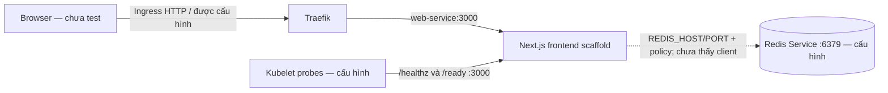
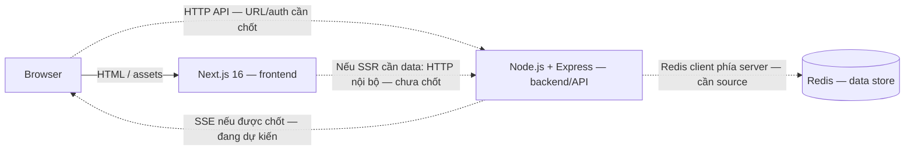
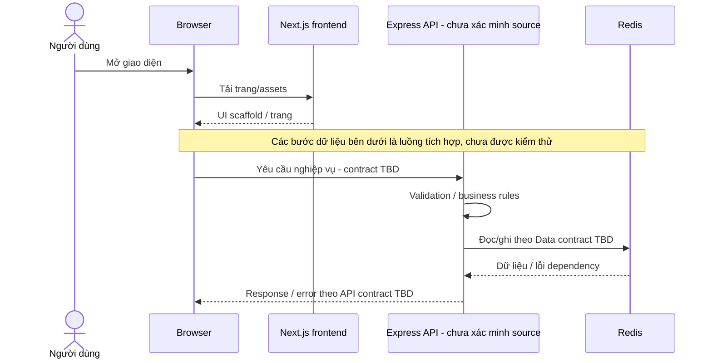
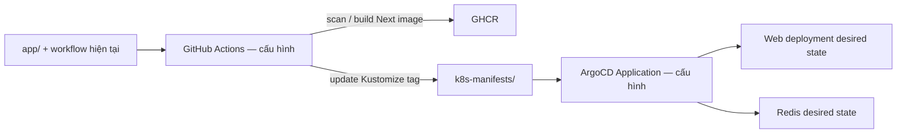

# NT548 — System Architecture

| Document ID | Version | Status | Date | Owner role | Baseline |
|---|---|---|---|---|---|
| NT548-ARCH | 0.2.0 | Draft — phân vai đã xác nhận, tích hợp cần kiểm chứng | 2026-11-04 | Web Fullstack / Platform Lead | [Commit 2110eddec91bc3e34137c86fef693095c4afb677](https://github.com/helios-ryuu/devsecops-gitops-with-k8s/commit/2110eddec91bc3e34137c86fef693095c4afb677), README/WBS/source; xác nhận của người dùng |

Thay đổi 0.2.0: tách frontend Next.js, backend Express và Redis; bổ sung luồng hiện có/luồng tích hợp; sửa diễn giải namespace, probe, runtime và dependencies. Đây là cập nhật tài liệu, không phải thay đổi topology triển khai hoặc application code.

## 1. Phạm vi và mức bằng chứng

Đồ án tập trung DevSecOps/GitOps trên Kubernetes Hybrid. Next.js 16 + Express + Redis là phân vai công nghệ do người dùng xác nhận. Ý tưởng AI Agent Workspace, simulator và SSE vẫn cần yêu cầu/contract riêng; không suy ra từ scaffold UI hoặc repo tham khảo.

Snapshot được pin theo commit trên; endpoint branches trả về một nhánh `main` tại thời điểm review. Không có checkout Express khác được cung cấp. Các nhận định “chưa tìm thấy” chỉ áp dụng snapshot đã duyệt, không kết luận thành phần không tồn tại trong local/repository khác.

## 2. Components và ownership

| Component | Trách nhiệm | Interface / dependency | Trạng thái trong snapshot |
|---|---|---|---|
| Browser | Hiển thị UI và tương tác | Nhận trang/assets từ Next; API data flow cần tích hợp | Không có browser test trong lần review |
| Next.js frontend — `app/` | Routing/render trang; UI; probes frontend hiện tại | Node runtime, React/Tailwind; Express API cho dữ liệu nghiệp vụ theo mô hình đã xác nhận | Có scaffold; `page.tsx` là starter, có hai probe Next |
| Express backend/API | Rules/validation, API response/error, thao tác dữ liệu | Node runtime; HTTP với consumer; Redis client phía server | Người dùng xác nhận vai trò; source/path/port/container chưa xác minh |
| Redis | Lưu dữ liệu theo nghiệp vụ và lifecycle được chốt | Protocol Redis/TCP phía server | Có Deployment/Service cấu hình; chưa thấy app client hoặc Data contract |
| Traefik / Web Service | Ingress route tới workload hiện tại | HTTP `/` -> web-service:3000 | Có cấu hình; chưa có route/backend Service Express riêng trong snapshot |
| CI / GHCR / ArgoCD | Build, scan, publish image, sync desired state | Context `app/`; GitOps `k8s-manifests/` | Có workflow/Application; chưa kiểm chứng lần chạy hoặc trạng thái live |
| Prometheus / Grafana | Quan sát hạ tầng/ứng dụng khi nguồn metrics tồn tại | Scrape/exporters/endpoint cần xác minh | Có cấu hình monitoring; chưa thấy `/metrics` application source |

Next route handler `/healthz` hoặc `/ready` là HTTP interface kỹ thuật của frontend hiện có. Nó không xác lập API nghiệp vụ Express. Không có bằng chứng code cho frontend -> Express -> Redis E2E trong snapshot này.

## 3. Hiện trạng mã nguồn và cấu hình

Sơ đồ này biểu diễn source/cấu hình, không khẳng định các thành phần đã chạy live. Mũi tên liền là định tuyến hoặc lời gọi có trong source/config; nét đứt là biến môi trường/quyền mạng, chưa phải lời gọi ứng dụng.

- `app/Dockerfile` build Next standalone; `CMD node server.js` là output Next. Image tag ghi Node 26.13.0; không đổi thành Node 24 trong tài liệu hiện trạng.
- Deployment Web khai báo 2 replicas, cổng 3000; Redis khai báo 1 replica, cổng 6379. Đây là desired state trong file, không là số Pod đang Running.
- Root Kustomization đặt namespace `production-app` cho `base`, `database`, `security`; `database/` là thư mục nguồn. Không mô tả Redis đã ở namespace `database` riêng.
- NetworkPolicy hiện chọn Redis và cho phép ingress TCP/6379 từ Pod `app: web` cùng namespace. Không có selector Express riêng; không suy ra backend mới sẽ tự được phép truy cập. Hiệu lực thực tế còn phụ thuộc môi trường/CNI và kiểm thử mạng. [Quy tắc selector của Kubernetes](https://kubernetes.io/docs/concepts/services-networking/network-policies/#behavior-of-to-and-from-selectors).
- ConfigMap có `REDIS_HOST=redis-service`, `REDIS_PORT=6379`; không có Redis client trong source ứng dụng đã quan sát. Manifest Redis không thể thay thế việc tích hợp application.

## 4. Luồng tích hợp theo phân vai đã xác nhận

Sơ đồ sau thể hiện mô hình cần dùng trong tài liệu. Nét đứt là giao tiếp chưa có bằng chứng tích hợp ở snapshot; chưa chốt host/path/port/process placement hoặc ingress rule mới.

1. Browser tải trang/assets từ Next.js. Khả năng này có scaffold và routing config; giao diện nghiệp vụ chưa được chứng minh hoàn chỉnh.
2. Khi cần dữ liệu nghiệp vụ, browser gọi HTTP API Express theo contract cần chốt. Nếu có SSR đọc dữ liệu, Next server cũng gọi Express; không mặc định thêm BFF/proxy hay truy cập Redis trực tiếp.
3. Express nhận request, áp validation/rules và gọi Redis client. Redis trả dữ liệu cho backend; backend ánh xạ sang wire schema, frontend cập nhật UI.
4. Nếu SSE được duyệt, backend cung cấp stream một chiều tới browser. Endpoint, event schema, auth, retry/reconnect, retention/replay và timeout cần được thiết kế; không coi SSE là đã có.

Browser không nhận Redis credentials. Nội dung `REDIS_*` hiện ở Web ConfigMap là cấu hình đã quan sát, không phải quyết định giao Redis ownership cho Next. Vị trí chuyển/tiêu thụ cấu hình sẽ là công việc triển khai riêng sau khi có source/backend design.

## 5. Delivery và deployment dependencies

Workflow hiện dùng build context `app/`, scan-ref `app` và cập nhật image tag trong `base/kustomization.yaml`. Điều này chưa bao gồm package/build context Express độc lập. Không tự tạo backend Dockerfile, Service, route, namespace hoặc pipeline. Cách đóng gói backend, routing browser/API, config/credentials và NetworkPolicy tương ứng là dependencies chưa giải quyết.

Nguồn mô tả K3s Hybrid, Tailscale, Cloudflare, VPS/on-prem và monitoring được giữ là bối cảnh/thiết kế dự án. Không dùng sơ đồ topology như minh chứng cluster đã triển khai, không suy ra CPU/RAM/SLA đã đo.

## 6. Health, readiness, metrics và chất lượng

| Interface / kỳ vọng | Hiện có | Khoảng trống / kiểm chứng cần làm |
|---|---|---|
| Next `/healthz` | GET trả 200 với status, uptime, timestamp | Chưa chạy test; không chứng minh Express hoặc Redis khỏe |
| Next `/ready` | GET trả 200 với ready/timestamp | Chưa kiểm tra dependency; không coi là E2E readiness |
| Express health/readiness | Chưa xác minh source | Cần xác định readiness gắn với dependency bắt buộc, trạng thái lỗi và startup/shutdown theo contract |
| `/metrics`, HTTP traffic metrics | Được README yêu cầu; chưa có source handler/prom-client | Cần xác định component sở hữu, scrape target và bằng chứng thu thập, không tự đặt port |
| Security/runtime | Web non-root/securityContext/NetworkPolicy có cấu hình | Kiểm thử enforcement và phân quyền Next/Express/Redis còn mở; không coi HTTP auth đã chốt |
| Data recovery | Redis manifest hiện không khai báo volume/persistence policy trong file đã đọc | Chưa có NFR về mất dữ liệu, TTL/retention, eviction/backup/restore; không hứa durable event history |
| Backend portability | Hướng Laravel tương lai | Contract và parity tests cần định nghĩa trước; Next frontend vẫn là consumer |

Chưa có FRD/NFR baseline định danh để map control theo ID. Không tự tạo SLA, performance target hay acceptance result. BA alignment ghi các handoff/gaps thay cho một ma trận PASS giả.

## 7. Quyết định, lựa chọn còn mở và tác động

- **DEC-NT-01 — người dùng xác nhận:** dùng đồng thời Next.js frontend, Express backend/API và Redis. Quyết định này xác lập phân vai; tiến độ source/live cần bằng chứng riêng.
- **A-NT-01 — đề xuất:** Express là owner truy cập Redis cho nghiệp vụ; Next/browser dùng HTTP contract. Điều này giúp giữ consumer contract khi thay Express bằng Laravel; chi phí là phải định nghĩa tích hợp và mapping rõ. Cần đối chiếu backend source để xác nhận cách hiện thực.
- **Q-NT-01:** source/backend entry point và package ở đâu? Người phụ trách: Web Fullstack. Không kết luận backend chưa được triển khai ngoài snapshot.
- **Q-NT-02:** consumer gọi API trực tiếp hay qua cùng origin/proxy; SSR cần gọi server-to-server không? Trade-off: trực tiếp giảm một hop nhưng cần chốt origin/auth; proxy có thể đơn giản hóa origin nhưng thêm responsibility. Chưa chọn cấu hình triển khai.
- **Q-NT-03:** runtime Node backend là phiên bản nào; cách đóng gói cùng/tách process/image? Frontend Docker tag không trả lời câu hỏi này.
- **Q-NT-04:** nghiệp vụ visit counter bắt buộc và scope AI Office/simulator/SSE, quyền truy cập, Data lifecycle và NFR nào đã được duyệt? Cần nguồn chấp nhận trước contract.
- **Q-NT-05:** backend routing, probes, config, network access, metrics và parity/recovery evidence còn thiếu. Thay đổi implementation chỉ được thực hiện trong nhiệm vụ riêng.

## 8. Evidence register và validation

Các đường dẫn sau cùng thuộc snapshot đã pin trong document control; không dùng trạng thái nhánh thay đổi làm baseline tĩnh.

| Evidence | Path | Kết luận được phép |
|---|---|---|
| E-NT-01 | README.md / WBS.md + xác nhận của người dùng | Business/project intent, phân vai; WBS status là báo cáo tiến độ, không là test log |
| E-NT-02 | app/package.json; app/next.config.ts | Next 16.4.3/React, pnpm, TypeScript, standalone config |
| E-NT-03 | app/src/app/page.tsx; layout.tsx; healthz/route.ts; ready/route.ts | Scaffold và hai probe Next; chưa có business API/Office trong source đã duyệt |
| E-NT-04 | app/Dockerfile | Next build/runtime image tag Node 26, non-root; không phải Express server proof |
| E-NT-05 | k8s-manifests/base/{deployment,service,ingress,configmap}.yaml | Desired Web routing/probes/config, không phải live status |
| E-NT-06 | k8s-manifests/kustomization.yaml; database/redis.yaml; security/network-policy.yaml | Namespace production-app, Redis desired state và policy selector |
| E-NT-07 | .github/workflows/ci-pipe.yml; argocd/app.yaml | Build context/frontend delivery và GitOps source/destination |
| E-NT-08 | Toàn bộ recursive tree tại commit đã pin và danh sách branches | Không tìm thấy backend Express trong phạm vi snapshot; không phủ định local/repo khác |

| Finding | So sánh | Kết quả / tác động |
|---|---|---|
| VAL-NT-01 | README/WBS phân vai Next/Express/Redis | PASS ở tài liệu cập nhật; không coi Next thay Express |
| VAL-NT-02 | Phân vai backend với source | BLOCKED — cần backend source; không gắn nhãn đã test/live |
| VAL-NT-03 | Mô tả namespace/probes với config/code | PASS về mô tả đã đối chiếu; live enforcement và dependency-aware readiness chưa xác minh |
| VAL-NT-04 | FRD/API/Data/NFR contract | BLOCKED — chưa có baseline; xem BA alignment |
| VAL-NT-05 | WBS status với nguồn kiểm chứng | Giữ báo cáo lịch sử; ghi riêng evidence/gaps và không tự công nhận hoàn thành E2E |

Tài liệu liên quan: [Technology Stack](technology-stack.md), [BA alignment](ba-documentation-alignment.md), [WBS](../WBS.md). Không thực thi application/build/cluster tests trong review tài liệu này.
