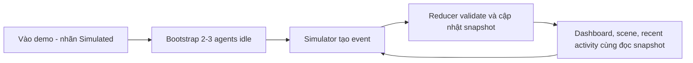

# FRD — Chức năng và quy tắc Web App

| Document ID | Document version | Status | Date | Owner role | Sources | Upstream |
|---|---|---|---|---|---|---|
| WEB-FRD | 1.0.0 | review | 2026-11-06 | Web Fullstack Dev; QA review | E-100..E-108 tại [registry](README.md) | WEB-BRD1.0.0; nguồn PT-FRD0.1.0 |

Change log 1.0.0: tổ chức lại [FRD practical](../validation/practical-test/02-FRD.md) theo workflow, nhóm chức năng, rules và acceptance criteria. Giữ 12 FR, 9 RULE, 15 AC và 7 NFR cùng ý nghĩa/commitment. Các hành vi mới vẫn proposed; không xem danh sách AC là kết quả test.

## 1. Actors và workflow

Người xem mở UI; simulator là actor nội bộ trong browser **nếu extension được chọn**. Probe consumer và metrics scraper là technical clients do nhóm quản lý. Release hiện không bao gồm administrator, login, task editor hoặc AI executor. Deployment access còn Q-102; thiếu auth feature không đồng nghĩa endpoint được duyệt public.

### Workflow bắt buộc

1. Người xem mở web và đọc nội dung release/counter.
2. App xử lý counter theo định nghĩa visit sẽ chốt ở Q-101. Redis lỗi thì hiển thị unavailable, không tạo số giả.
3. Operator kiểm tra liveness để biết process còn đáp ứng; kiểm tra readiness để biết điều kiện phục vụ theo target design.
4. Scraper lấy application metrics. Probe/scrape không làm tăng business visit count.

### Workflow extension có điều kiện

Event không hợp lệ không cập nhật snapshot/activity. Theo A-100/ADR-101 proposed, reload tạo demo run mới; không hứa shared state, lịch sử xuyên phiên hoặc real execution. Scenario/cadence/reset controls còn Q-107.

## 2. Chức năng bắt buộc

Các FR dưới đây có priority **High / Mandatory** theo BRD. Requested obligation và cách đặc tả proposed là hai khía cạnh riêng.

### FR-100 — Hiển thị giao diện Web App

- **Parent:** BR-100. **Actor/trigger:** viewer mở trang.
- **Kết quả:** render giao diện với nội dung của release đã chọn.
- **Lỗi/ngoại lệ:** counter lỗi hiện unavailable; không dùng probe healthy thay cho việc chứng minh UI render thành công hoặc assets tải được.
- **Interface/status:** UI, HTTP page ngoài OpenAPI JSON; starter code-observed, chưa tested. **Links:** RULE-100, AC-100.

### FR-101 — Ghi nhận và hiển thị lượt truy cập

- **Parent:** BR-101. **Actor/trigger:** viewer; visit trigger TBD Q-101.
- **Kết quả:** đọc/ghi counter Redis và hiển thị theo định nghĩa visit được duyệt.
- **Lỗi/concurrency:** không trả total=0 khi Redis unavailable; confirmed increments phải atomic. Timeout sau write có thể không rõ kết quả, retry/dedupe cần Q-101.
- **Interface/status:** HTTP counter operations BLOCKED Q-101; planned. Không tạo GET để increment counter. **Links:** RULE-100/RULE-101, AC-101/AC-102; ENT-100 ở Data.

### FR-102 — Kiểm tra liveness

- **Parent:** BR-102. **Actor/trigger:** probe GET `/healthz`, process còn phục vụ HTTP.
- **Kết quả:** 200, `status=ok`, uptime tính bằng giây và timestamp UTC; không mutate business state.
- **Dependency failure:** Redis down vẫn trả 200 nếu process còn đáp ứng. Process không trả lời được thì caller phát hiện timeout, không hứa app JSON error.
- **Interface/status:** `getLiveness`; code-observed, chưa runtime-tested. **Links:** RULE-102, AC-103.

### FR-103 — Kiểm tra readiness

- **Parent:** BR-102. **Actor/trigger:** readiness consumer GET `/ready`.
- **Target proposed:** 200 `status=ready` khi init hoàn tất, Redis check thành công trong deadline Q-104 và app chưa drain.
- **Lỗi proposed:** Redis error/timeout → 503 `DEPENDENCY_UNAVAILABLE`; init chưa xong/draining → 503 `NOT_READY`. Không lộ host/secret; không increment hoặc reset counter khi check.
- **Current evidence:** Next handler hiện luôn tạo 200, chưa kiểm tra Redis. Không mô tả target trên như code đã có.
- **Interface:** `getReadiness`. **Links:** RULE-102, AC-104/AC-105, ADR-102.

### FR-104 — Xuất application metrics

- **Parent:** BR-103. **Actor/trigger:** scraper GET `/metrics`.
- **Kết quả proposed:** Prometheus-compatible text; metric names/units/labels tại API, chờ Q-106.
- **Lỗi/boundary:** registry không phục vụ → 503; Redis down không ngăn scrape process/HTTP metrics; scrape không tăng visit. Labels không chứa dữ liệu nhạy cảm hoặc giá trị không giới hạn.
- **Interface/status:** `getApplicationMetrics`; planned, chưa có route implementation trong source. **Links:** RULE-103, AC-106.

### FR-105 — Bàn giao để đóng gói và tích hợp

- **Parent:** BR-104. **Actor/trigger:** Web/Platform bàn giao build.
- **Kết quả:** app có thể đóng gói container, nhận runtime config và phục vụ integration contract đã chốt.
- **Lỗi:** thiếu config bắt buộc → not ready; không nhúng credential vào image; runtime không cần root.
- **Interface/status:** internal/package, HTTP N/A vì đây là packaging; configured, chưa tested. **Links:** RULE-102, AC-107.

| Thuật ngữ / HTTP status | Cách hiểu tại các FR operational |
|---|---|
| Liveness | Process còn đáp ứng HTTP; không xác nhận Redis hoặc UI hoạt động đầy đủ |
| Readiness | Điều kiện phục vụ theo target init/dependency/drain; current handler chưa thực hiện target check |
| `200` | Đã tạo response thành công theo operation; ý nghĩa phụ thuộc `/healthz`, `/ready` hoặc `/metrics` |
| `503` | Response lỗi ứng dụng được đề xuất cho readiness/registry; không là bằng chứng đã có trong current source |
| Draining | App ngừng nhận traffic mới theo quy trình shutdown/rollout; deadline và ownership còn Q-104/Q-108 |

## 3. Chức năng extension có điều kiện

FR-106..FR-111 đều **Medium / Proposed MVP Extension**, chưa accepted/selected Q-100. Theo ADR-101 proposed, các chức năng là UI/internal browser và **HTTP N/A có lý do**, không cần tự thêm agents/task APIs.

| FR / parent | Trigger và kết quả quan sát được | Ngoại lệ / giới hạn | Links |
|---|---|---|---|
| FR-106 / BR-105 | Viewer vào demo: hiển thị agent ID/name/state/current task và các task đã tạo | Empty list có thông báo; unknown state không crash hoặc bị ép completed | RULE-104/RULE-105; AC-108/AC-114 |
| FR-107 / BR-105 | Demo active: simulator tạo events giả lập theo transitions | Một writer/browser; stop/unmount dừng timers; không thực thi command/model hoặc nhận external event chưa validate | RULE-104..RULE-106; AC-109/AC-113 |
| FR-108 / BR-105 | Reducer nhận assignment/result: cập nhật agent-task nhất quán | Busy agent, missing task, duplicate/out-of-order bị reject/no-op kèm diagnostic; không tiến state sai | RULE-104..RULE-106; AC-110/AC-113 |
| FR-109 / BR-106 | Mở office: 2–3 chibi tương ứng agent IDs | WebGL/init fail hiện 3D unavailable; dashboard text vẫn đọc state được; không cam kết optional 2D renderer | RULE-107; AC-111/AC-114 |
| FR-110 / BR-106 | State đổi: idle→rest, working→typing, completed→success gesture, failed→error gesture, kèm text label | Animation không thay business state; unknown state có diagnostic; không chỉ dùng màu | RULE-107; AC-111 |
| FR-111 / BR-106 | Event được chấp nhận: recent activity hiển thị mới nhất trước, timestamp, agent/task và nhãn simulated | Empty panel rõ; buffer capacity Q-107; không persisted history/filter | RULE-106/RULE-108; AC-112/AC-113 |

## 4. Business rules và state machine

| RULE | Định nghĩa chính | Source / parent / status |
|---|---|---|
| RULE-100 | Visit theo Q-101; probe/metrics/static assets không là business visits | BR-101; proposed interpretation; definition BLOCKED |
| RULE-101 | Mỗi Redis-confirmed increment có một atomic tăng. Timeout không chứng minh chưa tăng; không promise exactly-once hoặc unique visitor | BR-101; proposed, retry gate Q-101 |
| RULE-102 | Liveness chỉ process; target readiness gồm init + Redis dependency và chưa drain | BR-102/BR-104; proposed delta so với current ready |
| RULE-103 | Metrics labels không chứa agent/task IDs, raw URL, credentials hoặc task content | BR-103/BR-104; proposed bounded vocabulary |
| RULE-104 | Agent enum: idle/working/completed/failed. Task enum riêng: running/completed/failed | BR-105; agent enum user-provided; task rules proposed |
| RULE-105 | Agent tối đa một running task. Assignment tạo task ID mới; chỉ current running task được complete/fail. Terminal agent giữ task ref đến reset; reset bỏ ref | BR-105; proposed |
| RULE-106 | Một writer/browser; seq tăng trong demoRunId. Chỉ seq kế tiếp apply; duplicate no-op; gap/invalid ref reject + diagnostic, không thêm activity. New run clear state trước bootstrap | BR-105/BR-106; proposed |
| RULE-107 | UI/animation đọc snapshot; animation không trigger task completion | BR-106; proposed |
| RULE-108 | Recent buffer transient trong browser, không là retained history. Capacity Q-107; reload mất buffer có chủ ý | BR-106; proposed |

| Giá trị | Agent state | Task status |
|---|---|---|
| `idle` | Chưa có current task; ref null | Không dùng |
| `working` / `running` | Agent dùng `working` | Task đang xử lý dùng `running` |
| `completed` / `failed` | Agent phản ánh kết quả current task và giữ ref đến reset | Task terminal; không tự chạy lại |

Terminal nghĩa là completed hoặc failed. Task được giữ trong run tới khi clear run; reset agent không xóa task terminal. Bảng transitions là định nghĩa chính, không suy hành vi từ animation.

| Agent hiện tại | Trigger / guard | Agent kế tiếp | Task / tác động hoặc điều cấm | RULE |
|---|---|---|---|---|
| idle | task.started; task ID mới, agent không có task | working | Tạo running task và ref trong cùng reducer update | RULE-105/RULE-106 |
| working | task.completed; đúng current task | completed | Task→completed; giữ ref | RULE-105 |
| working | task.failed; đúng current task | failed | Task→failed; giữ ref | RULE-105 |
| completed/failed | agent.reset | idle | Ref→null; giữ task terminal đến new run | RULE-105 |
| idle | complete/fail | Forbidden | Không tạo task/state/event mới | RULE-105/RULE-106 |
| working | start task khác hoặc reset | Forbidden | Không overwrite task đang chạy | RULE-105/RULE-106 |
| terminal | complete/fail/start trước reset | Forbidden | Duplicate seq no-op; event mới sai transition reject | RULE-105/RULE-106 |

Không có auto-retry task hoặc auto-reset sau X giây được chốt. Q-107 xác định scenario/cadence, không tự biến failed thành working.

## 5. Acceptance criteria

Given/When/Then lần lượt là **điều kiện ban đầu → thao tác/sự kiện → kết quả mong đợi**. Những hàng còn BLOCKED không có đủ quyết định để nghiệm thu.

| AC | FR / RULE | Given | When | Then / case |
|---|---|---|---|---|
| AC-100 | FR-100 | Release mandatory được build | Mở web | UI render; counter lỗi hiện unavailable, không số giả / success+failure |
| AC-101 | FR-101, RULE-100 | Visit rule Q-101 được duyệt, Redis hoạt động | Visit hợp lệ và probe/scrape phát sinh | Chỉ visit hợp lệ đổi total đúng rule / expected delta BLOCKED Q-101 |
| AC-102 | FR-101, RULE-101 | Counter n, N confirmed increments, không reset/eviction | Hai clients ghi đồng thời | Total n+N; timeout báo unavailable/ambiguous, không retry mù / concurrency+failure |
| AC-103 | FR-102, RULE-102 | HTTP process đáp ứng, Redis unreachable | GET /healthz | 200 ok, uptime>=0, timestamp UTC, không tăng counter / alternate |
| AC-104 | FR-103, RULE-102 | Init xong, Redis check thành công | GET /ready | 200 ready và timestamp, không mutate business data / success target |
| AC-105 | FR-103, RULE-102 | Redis lỗi/timeout hoặc app drain | GET /ready rồi Redis phục hồi, hết drain | 503 trước; check đạt trả 200; không cần restart chỉ vì Redis / failure+recovery; deadline Q-104 |
| AC-106 | FR-104, RULE-103 | Registry ready, QA tạo traffic | Scrape /metrics | Parser Prometheus đọc được series đã chốt; labels không nhạy cảm; Redis down vẫn scrape / success+boundary; Q-106 |
| AC-107 | FR-105 | Image/build/config integration được chọn | Chạy local/staging, thử bỏ config Redis bắt buộc | Normal UI/probes accessible; thiếu config not ready; process không cần root / chưa thực thi |
| AC-108 | FR-106 | Extension được chọn, demo mới | Bootstrap 2–3 agents idle rồi task.started hợp lệ | Dashboard ID/name/state/task khớp snapshot, có simulated label / success |
| AC-109 | FR-107 | Demo active | Scenario start→result→reset rồi unmount | Chỉ event mô phỏng, transitions hợp lệ, unmount ngừng tạo events / cleanup |
| AC-110 | FR-108, RULE-105 | Agent working trên task A | Result task A; riêng case khác thử assign B khi A còn running | Case hợp lệ cập nhật task+agent; case busy reject, snapshot giữ nguyên / guard |
| AC-111 | FR-109/FR-110, RULE-107 | Cùng agent lần lượt qua bốn states | Render từng snapshot | 2–3 chibi, animation+text tương ứng; animation không đổi state / boundary |
| AC-112 | FR-111, RULE-108 | Capacity C được chốt Q-107 | Nhận C+1 valid events rồi reload | Giữ C mới nhất theo seq giảm, bỏ cũ nhất; reload tạo demo mới / conditional boundary |
| AC-113 | FR-107/FR-108/FR-111, RULE-106 | Event seq k đã apply | Nhận lại k hoặc k+2/unknown task | Duplicate no-op; gap/ref sai diagnostic, không activity/state sai / failure |
| AC-114 | FR-106/FR-109 | Empty snapshot hoặc WebGL init lỗi | Mở view | Empty text/3D unavailable; dashboard text đọc state được, không báo renderer thành công giả / alternative |

## 6. Non-functional requirements

| NFR | Parent / source | Target / điều cần đo | Conditions / verification | Commitment / gap |
|---|---|---|---|---|
| NFR-100 | BR-104, E-100/E-104 | Non-root container, runtime config tách image; configured UID10001:10001 | Inspect/build/run image | Requested integration; chưa chạy |
| NFR-101 | BR-102, E-100 | Readiness deadline/recovery observation Q-104 | Redis fail/restore, QA đo duration, tách liveness | Proposed semantics; target BLOCKED |
| NFR-102 | BR-105/BR-106, E-100 | 2–3 characters; FPS/memory/browser/GPU matrix Q-104 | Profile scene và tab lifecycle | Conditional, không lấy FPS reference làm SLA |
| NFR-103 | BR-104/BR-105, E-100 | Không real execution/credential access trong demo; exposure Q-102 | Review code/dependency/security, logs/network | Scope invariant; deployment access BLOCKED |
| NFR-104 | BR-101/BR-105, E-100 | RPO/RTO/persistence/eviction/max counter Q-103 | Redis loss/restart/concurrency characterization | Không promise durability |
| NFR-105 | BR-103/BR-104, E-101 | Scrape-compatible, bounded labels, shutdown/drain deadline Q-106/Q-104 | Parser/traffic/termination checks cùng Platform | Metrics required; limits pending |
| NFR-106 | BR-100/BR-106, E-100 | Không dùng màu/animation làm kênh state duy nhất; keyboard/accessibility standard Q-105 | Text labels, keyboard/manual review | Proposed; không claim WCAG compliance |

## 7. Traceability và review

[BRD](BRD.md) sở hữu BR mapping. [API](api-contract.yaml) mô tả FR-102→getLiveness, FR-103→getReadiness, FR-104→getApplicationMetrics; FR-101 giữ gap Q-101. FR-100 là HTML UI, FR-105 packaging, FR-106..FR-111 UI/internal theo ADR-101. [Data](data-contract.md) sở hữu ENT-100 cho counter, ENT-101..ENT-103 cho demo conditional. [Architecture](architecture.md) mapping đầy đủ NFR controls/gaps.

E-103 là code-observed probes, không chứng minh simulator. A-100 và task/event rules vẫn proposed; Q-100..Q-108 tại [registry](README.md). Nếu cần shared simulator/backend hoặc SSE, phải revise FR/API/Data/Architecture trước implementation.

| Finding | Check / severity | Locations / expected vs observed | Impact | Correction / owner | Result / follow-up |
|---|---|---|---|---|---|
| VAL-102 | Traceability / major | FR-100..FR-111 có BR hợp scope; ba operational operations, counter gap rõ | Không orphan FR, chưa full API | Giữ gap FR-101 / Web owner | Supported links bảo toàn; completeness BLOCKED |
| VAL-103 | Behavior / blocker | FR-101/AC-101/AC-102 cần Q-101 | Counter chưa nghiệm thu được | Chốt trigger/retry / Web owner + QA | BLOCKED |
| VAL-104 | NFR / major | NFR-101/NFR-102/NFR-104/NFR-105 còn thresholds | Chưa chứng nhận capacity/recovery | Q-103/Q-104/Q-106 / Web + Platform + QA | BLOCKED targets; runtime ACs chưa chạy |
