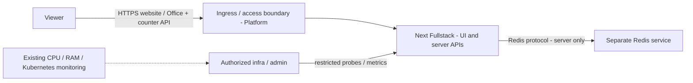
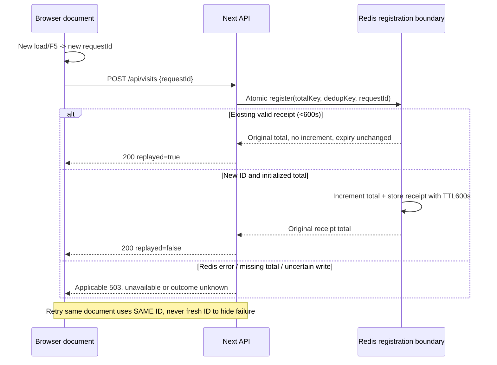
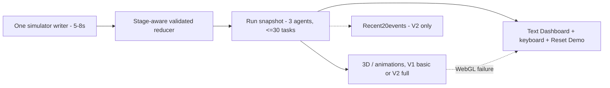

# Architecture — Next.js Fullstack, V1/V2 và Redis

| Document ID | Document version | Status | Date | Owner role | Sources | Upstream |
|---|---|---|---|---|---|---|
| WEB-ARCH | 1.1.0 | review | 2026-11-07 | Web Dev; Platform phối hợp | E-103/E-104/E-109 và [registry](README.md) | WEB-BRD/FRD/DATA1.1.0; WEB-API document 1.1.0/API 0.2.0; WEB-ARCH 1.0.0 |

Change log 1.1.0: ADR-100 chuyển sang Next Fullstack đã chốt; không target Express trong release. Thêm V1/V2, atomic page-view registration, probes 2 s/3 s/≈50 s, bốn metrics, Text Dashboard và readiness availability trade-off. Giữ ADR/NFR IDs. [PT-ARCH0.1.0](../validation/practical-test/04-architecture.md) chỉ là nguồn lịch sử.

## 1. Current evidence khác target

| Thành phần | Current observed / configured | Target V1/V2, không phải kết quả test |
|---|---|---|
| Next App Router | Next starter UI và hai probe handlers | Next Fullstack giữ UI và server APIs trong cùng app; không Express |
| Ready | Handler luôn trả 200; chưa đọc Redis | Init/config + Redis check tối đa 2 s + not draining; fail 503 |
| App Deployment | Standalone port 3000, 2 replicas, non-root; chưa startupProbe/explicit timeout 3 s | Probe integration theo NFR-101, Platform xác nhận timing tuple |
| Redis | Separate Deployment/Service/env; chưa volume/PVC trong manifest đọc | Total no TTL, dedup 600 s, persistence/backup/recovery plan |
| Counter/metrics/Office | Chưa thấy source implementation | APIs và bốn metric families V1; Office basic V1/full V2 |

Không claim live cluster, performance hoặc correctness từ files. C-100 đã giải quyết về release stack; C-101/C-102 và implementation gap C-103 vẫn được ghi tại registry. Không sửa application/manifests ở lượt này.

## 2. Boundaries và components

| Component | FR / Delivery Stage | Responsibility / interface | Data ownership |
|---|---|---|---|
| Next UI / Text Dashboard | FR-100/106/109/110; V1 basic, V2 full | HTML/client UI; Text Dashboard luôn đọc được state khi scene lỗi; keyboard | Presentation, không Redis credentials |
| Browser Demo Engine + Reducer | FR-107/108; V1 basic, V2 full | 3 Agents, 5–8 s, 30 tasks/run; one writer; Reset Demo/new run; stage guards | ENT-101..ENT-103 transient run |
| Scene Adapter | FR-109/110; V1 basic, V2 full | Snapshot→poses; dispose/unmount; không quyết định task result | Derived render state |
| Recent Activity | FR-111 V2 only | 20 accepted events, seq giảm; không persisted history | Projection từ ENT-103, không V1 panel/buffer |
| Next Route Handlers / HTTP Adapter | FR-101..104; V1, V2 | /api/visits GET/POST, /healthz, /ready, /metrics; serialize theo API 0.2.0 | HTTP transient receipts/errors |
| Counter Use Case + Redis Port | FR-101; V1, V2 | Validate requestId, atomic dedup+increment+receipt; exception mapping | ENT-100 total và request dedup |
| Process Metrics Registry | FR-104; V1, V2 | Four metric families; bounded labels; không đọc business total khi scrape | Per-process, reset khi process restart |
| Redis Runtime / recovery | FR-101/103, NFR-104 | Separate service; Platform storage/backup/restore, app encoding/TTL logic | Total và receipt keys; không agent/task store |

Port là giao diện domain/storage/scene nội bộ; adapter nối với Next, Redis hoặc rendering. Giữ business rules ngoài HTTP serialization để có thể thay server runtime tương lai, không tạo service/backend process mới trong release.

## 3. Luồng page view và retry

F5 khác request retry: mỗi load có ID mới; React re-render/double effect trong cùng load phải dùng cùng ID. GET đọc total không tăng. Reset Demo chỉ reset run browser, không POST visit hoặc reset total. Không lưu IP/cookie/account identity hoặc claim unique visitor.

**Design dẫn xuất cho atomic registration:** server-side Redis script/function hoặc cơ chế tương đương thực hiện lookup receipt, validate types/state, increment và store receipt như một unit không interleave giữa 2 Next replicas. Không dùng chuỗi client `GET→INCR→SET` rời rạc hoặc local-memory dedup. Prevalidate trước writes; preserve decimal precision; lỗi sau write/partial failures cần fault tests, không suy rollback/durability chỉ vì script atomic. Xem [Redis scripting semantics](https://redis.io/docs/latest/develop/programmability/eval-intro/) và Data cho giới hạn.

Dedup window 600 s, không refresh trên replay. Total không expiry/reset. Window hết, key mất/evicted hoặc recovery mất state thì không bảo đảm exactly-once. Client dừng automatic retry sau 600 s từ first attempt và hiện outcome unknown; không tự new ID để resend một load cũ.

## 4. Simulator và fallback

V1 không hiện Agent completed/failed hoặc FR-111. Chi tiết basic finish→Idle vẫn là design proposal Q-107 ở FRD; V2 có terminal/ref/reset rules đầy đủ. Một running task/Agent, task 30 là giới hạn của cả run; không âm thầm new run để tiếp tục. Reset Demo/reload tạo run mới, clear old run/timers, bootstrap 3 Agents. Reload cũng là page view mới; Reset Demo không là visit.

Snapshot là nguồn cho dashboard/scene; animation không sửa domain. Unmount/remount phải cleanup và ngăn duplicate engines.3D lỗi không làm task failed; Text Dashboard và keyboard vẫn dùng cùng snapshot, không bổ sung renderer 2D/SSE/real agents.

## 5. Readiness, startup và ảnh hưởng AI Office

| Control | Accepted target | Design proposal / residual |
|---|---|---|
| /healthz | Process-only, độc lập Redis | Dùng làm candidate startup/liveness target; không kiểm business total |
| /ready | Init/config đủ, Redis check bounded 2 s, không drain; 200/503 đúng API | Disable/bound retries trong 2 s; PING/check quyền command cần Web/Platform xác nhận |
| Kubernetes readiness | timeoutSeconds=3 | Period/failureThreshold/propagation và tổng handler overhead cần test, không assume tức thời |
| startupProbe | Budget khoảng 50 s | Candidate /healthz, periodSeconds 5, failureThreshold 10, timeoutSeconds 3; 10 × 5≈50 s là planning budget, không exact wall-clock SLA; Platform phê duyệt tuple trước sửa manifests |
| Recovery | Redis khỏe lại thì lần valid ready check có thể 200 | Không cần restart chỉ vì Redis down; QA đo propagation và routing phục hồi |

Startup probe kiểm process khởi động để Redis outage không biến thành restart loop do startup dependency check. Startup thành công rồi readiness/liveness hoạt động theo configuration; đây là đề xuất tích hợp, không manifest đã áp dụng. [Kubernetes probe documentation](https://kubernetes.io/docs/tasks/configure-pod-container/configure-liveness-readiness-startup-probes/) giải thích startup gate và NotReady routing; triển khai thực tế phải test.

**Trade-off đã phải làm rõ:** readiness gắn vào toàn bộ Next pod, không chỉ counter API. Redis lỗi làm NotReady; khi endpoints bị rút, HTML/API/Office requests mới có thể thất bại nếu không còn Ready pod. Browser đã tải JS/snapshot có thể tiếp tục local demo và hiện counter unavailable, nhưng refresh/new viewer vẫn cần server. Không cam kết AI Office sẵn sàng độc lập Redis hoặc tự tách route/service để né target đã chốt.

Liveness 200 không chứng minh UI/Redis khỏe. Metrics registry trong process vẫn có thể export, nhưng Service scrape có thể mất khi pod NotReady; Platform cần đường scrape Pod/monitoring phù hợp với authorization thay vì promise Service luôn reachable.

## 6. Access và observability

Platform phải giới hạn /healthz, /ready, /metrics và monitoring tools cho infra/authorized admin bằng routing/network/monitoring grants đã duyệt. Không tin browser-supplied `admin` header hoặc coi tên stakeholder là quyền. Product UI/counter viewer access không cấp quyền probes/scrape. Không thêm app login V1; exact grants/origin/rate/deny responses còn Q-102.

| Metric family | Type / unit / labels | Source / limits |
|---|---|---|
| web_app_process_uptime_seconds | gauge, seconds, no labels | Process lifetime |
| web_app_http_requests_total | counter, requests; method/route/status_code | Completed requests per process, không global visitor total |
| web_app_http_request_duration_seconds | histogram, seconds; method/route; bucket `le` derived | Completed response duration; buckets Q-106 |
| web_app_redis_up | gauge 0/1, no labels | Last completed bounded dependency check; 0 on failure/timeout hoặc chưa success, 1 success; freshness qualification Q-106 |

Route label chỉ registered template hoặc unmatched; method allowlist/OTHER; không raw URL/query, requestId, agent/task IDs, user/secret/free text. Bucket/sum/count là phần histogram family, không thêm business metrics. CPU/RAM/Kubernetes lấy từ monitoring hạ tầng hiện có. Scrape không đọc total hoặc increment; Redis down không ngăn process/HTTP export.

## 7. NFR realization

| NFR | Control / component | Verification | Gap còn lại |
|---|---|---|---|
| NFR-100 | Next standalone/non-root/runtime config | Build/run UID/writable paths | Config mới là observed; không đổi image ở đây |
| NFR-101 | Redis 2 s/readiness 3 s/startup≈50 s; process-only liveness | Fail/timeout/restore/startup/endpoints/Office tests | Tuple/depth/drain và overhead Platform/QA |
| NFR-102 | 3 Agents, 5–8 s, 30 tasks/run, stage-specific scene | Browser/task cap/cadence/unmount profile | FPS/memory/device targets Q-104 |
| NFR-103 | Viewer vs infra/admin boundary, no login/real execution | Allow/deny/network/dependency review | Grants/deny/origin Q-102 |
| NFR-104 | Shared Redis atomic total+receipt, total no TTL, dedup 600 s, no reset | Concurrent/retry/TTL/loss/restart/restore tests | Storage/persistence/backup/RPO/RTO Q-103 |
| NFR-105 | Four metric families, bounded labels, graceful drain | Parser/traffic/latency/scrape target checks | Buckets/freshness/wiring Q-106, drain Q-104 |
| NFR-106 | Text Dashboard fallback, keyboard, text labels | WebGL-fault + keyboard/manual review | Device/standard qualification Q-105 |

## 8. ADRs — IDs được giữ

| ADR / status | Problem / alternatives | Decision / design | Trade-off / revisit |
|---|---|---|---|
| ADR-100 / accepted E-109 | Next Fullstack hay separate Express | Next giữ UI+server APIs, Redis riêng; previous Express proposal superseded | Fullstack readiness ảnh hưởng cả Office; không release Express |
| ADR-101 / retained design, A-100 | Browser-local hay shared server simulator | Browser one writer/reducer; stage split theo E-109 | Không shared/persistent agents; revisit khi scope mới được duyệt |
| ADR-102 / accepted targets; tuple proposed | Ready always 200 hay dependency-aware | Redis 2 s/probe 3 s/startup≈50 s, not draining; giữ success body, 503 lỗi | PING/write-depth và Platform config chưa approve; current ready chưa khớp |
| ADR-103 / proposed reuse design | Copy reference hay chọn module | ADAPT rig/renderer/camera, BUILD mapper/demo; SKIP CLI/accounts/extras | Cleanup/license audit trước reuse; [reference matrix](../validation/practical-test/07-reference-analysis.md) |
| ADR-104 / accepted metric set; details design | Process observability độc lập counter | 4 families, bounded labels, last-check redis_up, không app CPU/RAM/K8s duplication | Buckets/freshness/scrape target xác nhận Q-106 |

Domain không chứa Next Request/Response hoặc Laravel models. Redis Port giữ serialization/atomicity; ScenePort đọc logical snapshot. Future migration phải giữ contract/domain, không đổi UI stack hoặc thêm Express chỉ để có baseline. ADR-105 rollout thuộc Migration.

## 9. Findings và evidence boundary

| ID | Check / severity | Locations / expected vs observed | Impact | Correction / owner | Result / follow-up |
|---|---|---|---|---|---|
| VAL-105 | Design consistency / major | Next Fullstack, Redis riêng, browser-local V1/V2; no agent API | Giữ selected scope | Cross-check API/Data/stages / Web+QA | Document consistency; runtime chưa chạy |
| VAL-106 | Integration / blocker | Current ready/probe/Redis persistence khác target 2 s/3 s/≈50 s | Chưa deployment/availability/restore evidence | Platform/Web implementation và QA fault tests | BLOCKED execution; không còn Express split blocker |

Chỉ tài liệu được cập nhật. Diagrams mô tả target hoặc observed source, không phải deployment logs. Source/runtime/independent review limits tại [registry](README.md).
