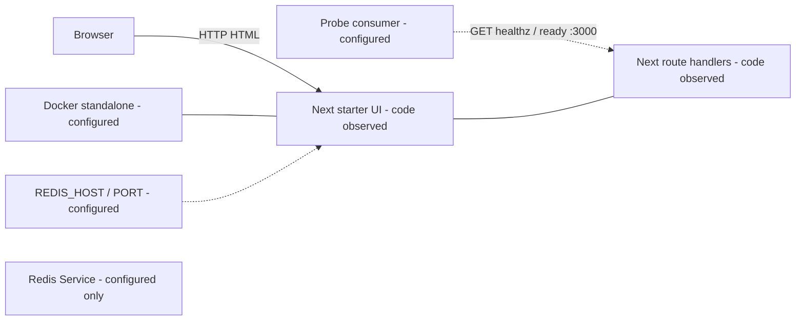
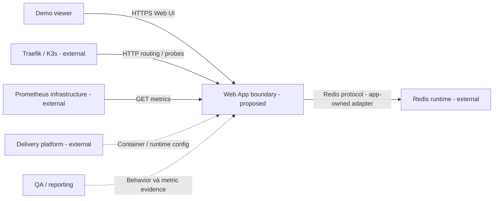
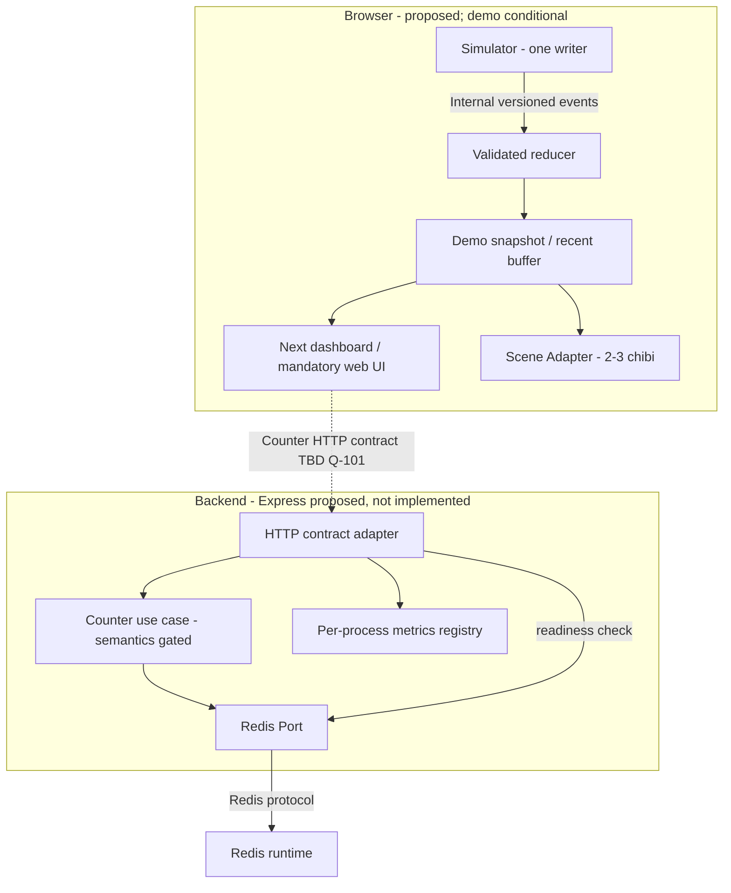
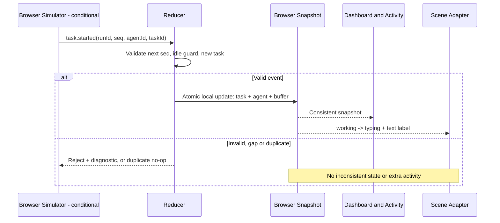
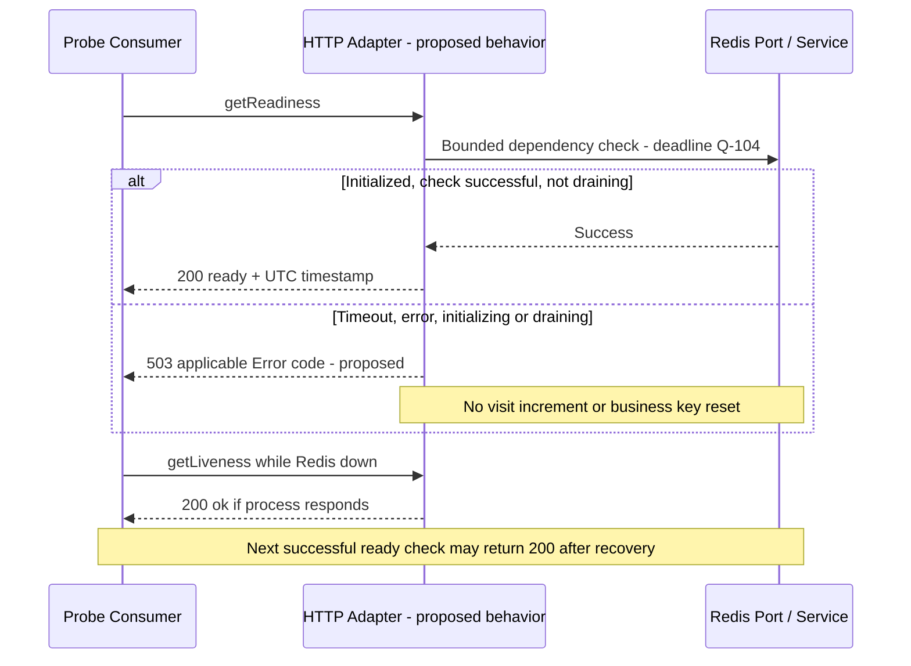
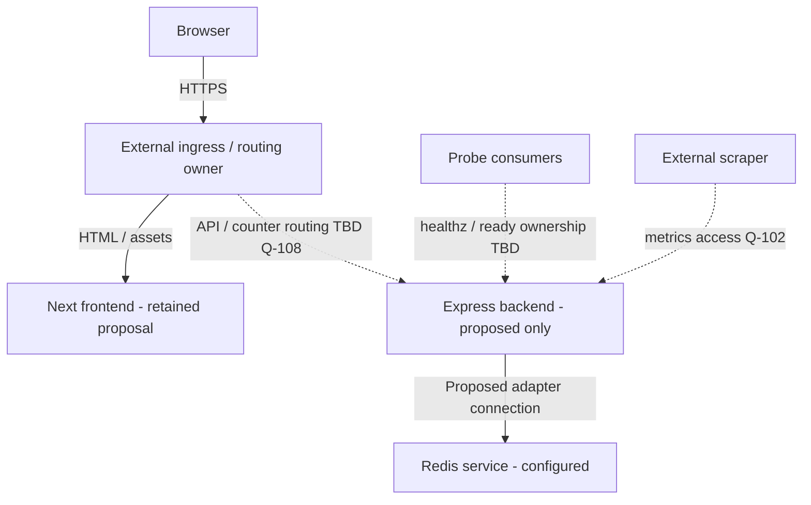

# Architecture — Thành phần, luồng xử lý và tích hợp Web App

| Document ID | Document version | Status | Date | Owner role | Sources | Upstream |
|---|---|---|---|---|---|---|
| WEB-ARCH | 1.0.0 | review | 2026-11-06 | Web Fullstack Dev / Solution Architect; Platform phối hợp | E-100..E-108 tại [registry](README.md) | WEB-BRD/WEB-FRD1.0.0; WEB-API document1.0.0/API0.1.0; WEB-DATA1.0.0 được đối chiếu; nguồn PT-ARCH0.1.0 |

Change log 1.0.0: biên tập từ [Architecture practical](../validation/practical-test/04-architecture.md); tách hiện trạng, target proposed, luồng xử lý và deployment. Giữ components, ADR-100..ADR-104, NFR controls và các giới hạn. Các diagrams mô tả code/config hoặc design có nhãn rõ; không chứng minh live deployment.

## 1. Ranh giới trách nhiệm

| Boundary | Sở hữu |
|---|---|
| Web App | UI, application HTTP/domain logic, Redis adapter và application metrics |
| Platform | Routing, K3s/Tailscale/Traefik, policy, container delivery và scrape infrastructure |
| QA/Observability | Chạy test/load, đánh giá và báo cáo bằng chứng; Web cung cấp behavior/metrics kiểm tra được |

CI/CD và cluster là các ràng buộc tích hợp, không biến thành product feature của Web. Redis là external runtime nhưng adapter và ý nghĩa dữ liệu counter thuộc ứng dụng. Không đưa credential Redis vào browser.

## 2. Hiện trạng được quan sát

| Thành phần | State | Evidence / giới hạn |
|---|---|---|
| Next16.4.3 / React19.3.0 | Dependency configured; starter code-observed | E-103; chưa chứng minh UI chức năng ngoài starter hoặc runtime |
| GET /healthz và /ready | Code-observed tại Next handlers | Ready hiện luôn 200, không Redis check; chưa HTTP-tested |
| Docker standalone, port3000, UID10001:10001 | Configured | E-104; chưa build/run |
| Redis service/env/NetworkPolicy | Configured external | E-104; app chưa Redis client; root Kustomize production-app |
| Express/prom-client/Redis application integration | Planned/intended | README + brief; chưa thấy implementation/dependency trong app |
| Three.js/simulator/agent dashboard | Proposed extension | Chưa selected Q-100, chưa source |
| SSE | Optional/deferred | Không thêm connection manager/broker vào candidate topology |
| Live deployment | Unknown | Không suy running từ manifests |

Không vẽ cạnh Next→Redis như kết nối implementation hiện tại vì chưa có client. Next có cả UI và hai HTTP probes, nhưng điều đó không chứng minh đã thay Express. C-100/C-101/C-102 ghi rõ gap Express, Node version strings và Redis namespace. Trong root config được đọc, resources cùng production-app nên không tự gọi hostname `redis-service` là lỗi cross-namespace.

## 3. Kiến trúc dự kiến và components

Các phần sau là **proposed design**. Extension chỉ active khi Q-100 được chốt; Next/Express topology và probe ownership còn Q-108.

| Component | Responsibility / FRs | Interface | Dữ liệu và dependency | Hướng xây dựng |
|---|---|---|---|---|
| Next UI | FR-100/FR-106/FR-109..FR-111; text usable nếu scene lỗi | HTML/React snapshot | Presentation state, không Redis secrets | BUILD UI; ADAPT visual ideas |
| Browser Demo Engine — conditional | FR-107/FR-108; một writer và reducer | Internal SimEvent→Snapshot | ENT-101..ENT-103 transient/run | BUILD simulator tối thiểu, không server ingestion |
| Scene Adapter — conditional | FR-109/FR-110; state→poses và lifecycle dispose | Snapshot + agent IDs→ScenePort | Derived render state | ADAPT rig/renderer, không copy workers.js wholesale |
| Application HTTP Adapter | FR-102/FR-103/FR-104 | getLiveness/getReadiness/getApplicationMetrics | Transient statuses và per-process registry | Express proposed; Next handlers current |
| Counter Use Case + Redis Port | FR-101 | HTTP TBD Q-101; increment/read nội bộ | ENT-100 | BUILD, không phụ thuộc ORM/framework domain types |
| Metrics Registry | FR-104, NFR-105 | Prometheus text; completed-request hooks | Process-local series, không business visitor total | BUILD/chọn thư viện tương thích sau |
| Redis Runtime | FR-101/FR-103 | Redis adapter theo config | Counter authoritative trong loss limits còn Q-103 | External configured; không thêm broker |

Simulator không gọi agents backend API trong ADR-101. Redis không được chọn làm agent/task/event store. HTTP/Data contract định nghĩa ý nghĩa trước implementation; Express/Laravel defaults không là canonical schema.

### Các thuật ngữ tại ranh giới dữ liệu

| Thuật ngữ | Ý nghĩa trong kiến trúc này |
|---|---|
| Reducer / snapshot | Reducer validate event rồi cập nhật một trạng thái nhất quán; dashboard/scene chỉ đọc snapshot đã commit |
| Port / adapter | Port là giao diện nội bộ cần giữ ổn định; adapter nối nó với HTTP framework, Redis hoặc rendering cụ thể |
| Derived render state | Pose/animation được suy ra từ domain snapshot, không là nguồn cập nhật task/agent |
| BUILD / ADAPT / SKIP | Tự xây phần cần thiết / điều chỉnh có chọn lọc / không đưa vào phạm vi; chưa có nghĩa source đã được reuse |

## 4. Luồng xử lý chính và lỗi

### Simulator → snapshot → UI/scene

RULE-104..RULE-108 ở FRD sở hữu transitions/guards. Data sở hữu logical fields và commit boundary, không thêm API event ingestion.

### Readiness khi Redis bình thường, lỗi và phục hồi

PING chỉ là candidate check, không chứng minh write permission. Check depth/deadline còn Q-104. Counter success/failure sequence chưa thể chốt trigger/retry trước Q-101; Data vẫn phân biệt atomic increment và timeout sau write.

## 5. Deployment và integration contract

| Environment / node | Network/config/owner | Giới hạn cần giải quyết |
|---|---|---|
| Current app container config | Next standalone :3000, non-root; ConfigMap PORT/REDIS_HOST/REDIS_PORT | Backend split chưa có trong Dockerfile/CI hiện tại |
| Proposed frontend + Express backend | Same-origin routing là preference proposed; port/origin/container count Q-108 | Platform chốt probe/UI relationship; backend ready không chứng minh frontend render |
| Redis service | Cùng namespace theo root config; adapter app kết nối, browser không truy cập trực tiếp | Credentials/TLS/persistence chưa chốt; Platform quản lý secret injection nếu có |
| Local / cluster | Chưa runtime/live-verified | Không thiết kế lại K3s/Tailscale/NetworkPolicy |

Trước backend split phải chốt binding port, origins/routing ownership, shutdown signal và drain deadline Q-108/Q-104. Không giả định Express có thể được thêm vào standalone Next packaging hiện tại mà không đổi integration. Bộ tài liệu nêu dependency này; không tự sửa application/infra.

## 6. NFR realization

| NFR | Control / component | Trade-off và verification | Evidence / gap |
|---|---|---|---|
| NFR-100 | Non-root config hiện có; backend proposed theo cùng nguyên tắc | Build/run, kiểm tra UID và writable paths | Configured; backend image Q-108 |
| NFR-101 | HTTP adapter Redis check có timeout; drain readiness | PING nhẹ nhưng không chứng minh writes; QA đo fail/restore | Check depth/deadline Q-104 |
| NFR-102 | Scene Adapter, 2–3 rigs, cap pixel ratio, selective static merging | Profile trước bloom/advanced merge; dispose/unmount | Hardware/FPS/memory targets Q-104 |
| NFR-103 | Synthetic events, không host-file/CLI ports, access review | Giảm credential surface; auth feature tương lai không giải metrics exposure | Access/origins Q-102 |
| NFR-104 | Redis atomic increment, explicit missing/timeout behavior, demo transient | Atomic không đồng nghĩa durable | Loss/eviction/backup/RPO/RTO Q-103 |
| NFR-105 | Per-process registry, bounded labels, not-ready khi drain | Parser/traffic tests, shutdown coordination Platform | Metric vocabulary Q-106, drain Q-104 |
| NFR-106 | Text/dashboard ngoài canvas; labels ngoài màu/animation | Keyboard/accessibility review; optional 2D renderer chưa chọn | Standard/devices Q-105 |

## 7. Vận hành, recovery và reuse

| Sự cố | Hành vi target / điều cần phân biệt |
|---|---|
| Redis down | Counter unavailable; ready503 proposed; liveness200 nếu process đáp ứng; metrics export độc lập |
| Counter write timeout | Có thể đã tăng; không auto-retry khi policy chưa chốt; không reset count |
| Missing/evicted key | Không tự suy total=0; init/restore authority ở Q-103 |
| Registry lỗi | 503 METRICS_UNAVAILABLE proposed; không phụ thuộc business state |
| WebGL/init lỗi | Scene unavailable, text dashboard giữ state; renderer fail không làm task failed |
| Unmount / nhiều replicas | Cleanup timers; một simulator writer/browser; mỗi browser là demo độc lập |

Hai replicas được cấu hình không cho phép tự thêm simulator timer/server trên mỗi pod. Shared world cần quyết định single writer/leader, source of truth, retention, CAS và fan-out trước khi revise contracts. Không thêm Redis Pub/Sub chỉ để chuẩn bị future.

E-108 và [ma trận reference](../validation/practical-test/07-reference-analysis.md) là bằng chứng cho chọn lọc visual modules: ADAPT chibi/basic poses, renderer/camera và một phần desk scene; BUILD state mapper, minimal simulator/reducer/UI và Redis counter; SKIP real-session backend, CLI/hooks/accounts và extra city features. Pure helpers chỉ reuse sau extraction/notice. Source MIT không tự xác minh quyền của từng third-party asset/font/brand/vendor; audit trước khi reuse. Chưa copy/chạy reference trong lần chuyển Official.

## 8. Architecture decisions và portability

| ADR / status | Problem / alternatives | Proposed choice / lý do | Cost / revisit trigger |
|---|---|---|---|
| ADR-100 / proposed | Current Next routes và separate Express intent | Giữ current Next rõ ràng; target tách HTTP/domain/Redis ports | Thêm deployable cần Q-108; xem lại nếu backend tiếp tục Next |
| ADR-101 / proposed, A-100 | Browser-local hay shared-server simulator | Browser event/reducer gọn, không auth/mutation/SSE | Không shared/persistent agents; revisit khi viewers cần cùng state |
| ADR-102 / proposed | Always200 hay dependency-aware ready | Init + bounded Redis check + not draining; giữ success body, thêm503 | Operational change cần probe owner và Q-104 |
| ADR-103 / proposed | Copy cả office hay chọn visual modules | ADAPT rig/renderer/camera; BUILD mapper/UI; SKIP CLI/accounts/extras | React cleanup/licensing effort; theo ma trận reference |
| ADR-104 / proposed | Observability phụ thuộc domain/Redis hay process-local | Local registry, no Redis read để scrape, bounded labels | Metric set Q-106; process restart reset counters |

Domain event/state không chứa Express request/response hoặc Laravel model types. Redis Port sở hữu encoding/atomic operation; HTTP adapter serialize theo API; ScenePort nhận domain snapshot, không phụ thuộc My Office sess/desk fields. Những seams này là design proposed, chưa implementation evidence. ADR-105 rollout strategy thuộc [Migration](migration-plan.md).

## 9. Evidence, impact và review

E-103/E-104 là code/config; E-108 chỉ technical reference. A-100 và mọi ADR còn proposed; Q/C ở [registry Official](README.md). Chọn shared simulator, SSE hoặc persistence sẽ tác động FR-107/FR-108/FR-111, API coverage, ENT-101..ENT-103 và migration; cần đồng bộ trước accepted baseline.

| Finding | Check / severity | Locations / expected vs observed | Impact | Correction / owner | Result / follow-up |
|---|---|---|---|---|---|
| VAL-105 | Architecture consistency / major | Architecture/API/Data: browser simulation transient, no stream/history promise | Không hứa replay từ ephemeral state | Giữ ADR-101 / Web owner | Design consistency của nguồn được bảo toàn; runtime chưa kiểm tra |
| VAL-106 | Integration / blocker | E-104 standalone Next khác target Express split Q-108 | Target chưa deployable-ready | Chốt topology/probes/runtime / Web + Platform | BLOCKED readiness |

Các diagrams không phải log triển khai. Resource fit, routing, live policy và operational tests cần được kiểm chứng trong công việc implementation/QA riêng.
