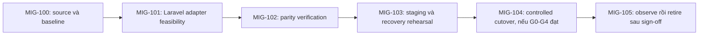

# Migration Plan — Định hướng Express → Laravel

| Document ID | Document version | Status | Date | Owner role | Sources | Upstream |
|---|---|---|---|---|---|---|
| WEB-MIG | 1.0.0 | review | 2026-11-06 | Web owner; migration authority còn Q-100/Q-108 | E-100 định hướng tương lai; E-103 source snapshot `2110eddec91bc3e34137c86fef693095c4afb677`; [registry](README.md) | WEB-BRD/WEB-FRD/WEB-ARCH/WEB-DATA1.0.0; WEB-API document1.0.0/API0.1.0; PT-MIG0.1.0 |

Change log 1.0.0: biên tập [Migration practical](../validation/practical-test/06-migration-plan.md) thành tài liệu Official về feasibility, invariants, gates và recovery. Giữ MIG-100..MIG-105, ADR-105 và trạng thái tương lai/deferred. **Source-baseline discovery: BLOCKED. Migration readiness: BLOCKED.** Tài liệu chưa là runbook có thể thực thi.

## 1. Mục tiêu và phạm vi migration

Định hướng là thay backend Express bằng Laravel trong tương lai, đồng thời giữ hành vi nghiệp vụ, API và Data contracts đã được chốt. Business case định lượng, ngân sách và quyết định thực hiện chưa có nguồn. BR-108 vẫn deferred; migration không là điều kiện nghiệm thu NT548.

Source hiện quan sát được là Next starter và probes, chưa có Express dependency/server/routes/tests trong app đã đọc. Không đổi nhãn Next handlers thành Express baseline và không chuyển frontend sang Laravel trong kế hoạch này. Laravel version, runtime/extensions/dependencies chưa được chọn.

Consumers dự kiến gồm frontend counter UI (contract còn mở), probe consumers và external scraper. Browser simulator theo ADR-101 không biến thành Laravel worker; optional SSE, real agents và auth nằm ngoài parity baseline hiện tại.

## 2. Điều kiện đầu vào và mức tin cậy

| Baseline inventory | Observed / gap | Tác động |
|---|---|---|
| Express routes/middleware/source ref | Chưa thấy trong inspected app | MIG-100 BLOCKED; cần source thực tế và characterization tests |
| Next probes | Success JSON code-observed; ready luôn200 | Discovery input, không là bằng chứng Express parity |
| API0.1.0 / WEB-API document1.0.0 | Partial contract; ready/metrics có proposed deltas | Cần accepted/versioned behavior baseline trước migration |
| WEB-DATA1.0.0 | Logical/proposed; counter lifecycle/TTL/semantics còn mở | Chưa storage compatibility guarantee |
| Tests/production traffic/data volumes | Chưa characterization evidence | Không tự đặt cutover date/window/rollback time |

Official là bộ tham chiếu chính; các upstream hiện `review`, không tự trở thành accepted baseline cho migration. Các nghiệp vụ độc lập có thể tiếp tục phát triển trong khi discovery migration còn BLOCKED.

## 3. Contract invariants và parity

Parity là việc old/new implementation đáp ứng cùng baseline, không chỉ chạy được cùng route. Golden fixtures là bộ request/expected response được chốt để so sánh. Framework defaults không chứng minh parity.

| Invariant / trace | Old evidence | Target obligation khi migration được duyệt | Verification / pass condition | Status / owner |
|---|---|---|---|---|
| FR-102, AC-103, getLiveness | Next handler E-103; Express missing | Status/uptime/timestamp theo accepted API; Redis-independent | Golden responses, Redis down, schema/units/time tests | BLOCKED old baseline / Web + QA |
| FR-103, AC-104/AC-105, getReadiness | Current Next always200 khác proposed behavior | Giữ accepted200/503/error codes/deadline | Redis failure/restore/init/drain cases equivalent | BLOCKED Q-104 + Express / Web + Platform |
| FR-104, AC-106, getApplicationMetrics | Chưa source implementation | Giữ text format/names/types/labels/process-reset meaning | Prometheus parser, traffic deltas và scraper integration | BLOCKED Q-106 / Web + QA |
| FR-101, AC-101/AC-102, ENT-100 | Counter route/key chưa có | Giữ visit trigger/idempotency, integer encoding, key/TTL | Concurrent visits, timeout ambiguity, restart/restore characterization | BLOCKED Q-101/Q-103 / Web |
| JSON/error edge cases | Chưa capture framework behavior | 404/405/validation status+envelope, absent/null, string IDs, UTC và []/{} theo baseline | Positive/negative consumer fixtures, không dựa Laravel defaults | BLOCKED discovery / Web + QA |
| Access/origin/security | Q-102 còn mở | Giữ auth middleware nếu baseline có, CORS/CSRF/cookies/slash/method behavior | Browser/probe/scraper integration và applicable denied cases | BLOCKED / Web + Platform |
| FR-106..FR-111, RULE-104..RULE-108 | Proposed browser demo | Backend replacement không thay simulator/task/state/animation rules | Frontend regression AC-108..AC-114 | Conditional Q-100 |
| NFR-100..NFR-106 | Chưa runtime evidence | Giữ non-root, readiness, capacity/recovery/access/metrics/text-usability obligations | Đo cùng workload/environment với thresholds đã duyệt | BLOCKED thresholds/tests |

Uptime/timestamp có thể thay đổi tự nhiên giữa process và lần gọi; so sánh meaning, types, ranges và time encoding, không yêu cầu cùng giá trị thời gian. Counter counts và data integrity phải theo rules đã chốt.

Chuyển readiness always200 sang dependency-aware là **operational contract change**, không ngụy trang thành framework replacement parity. Nếu cần thay baseline, ghi proposal riêng, version và consumer approval trước migration.

## 4. Strategy và gates

| ADR / status | Alternatives | Proposed approach / lý do | Costs / revisit |
|---|---|---|---|
| ADR-105 / proposed, migration-owned | Single routing cutover; incremental routes; shadow reads | Một cutover sau staging parity, giữ Redis schema và single active writer để giảm độ phức tạp | Maintenance/drain requirements còn TBD; incremental tăng routing ownership; shadow chỉ read-only, không tính thêm visits |

Chưa selected strategy do thiếu old system và downtime tolerance. Không dual-write counter để so sánh, không shadow mutating endpoint. Đổi topology/traffic/risk cần review ADR-105 trước runbook.

| Gate | Điều phải được chốt / chứng minh |
|---|---|
| G0 — Business authority | Q-100: scope/authority phù hợp và quyết định thực hiện migration |
| G1 — Baseline | MIG-100: verified Express source và accepted contracts |
| G2 — Contract parity | MIG-102: parity matrix không còn FAIL/BLOCKED |
| G3 — Recovery | MIG-103: diễn tập recovery, data compatibility và limits đạt |
| G4 — Operations | Q-102/Q-104/Q-108: access, thresholds, topology/window/drain/rollback ownership |

## 5. Phases và entry/exit criteria

| MIG | Entry / dependencies | Deliverable / owner | Exit evidence / lịch |
|---|---|---|---|
| MIG-100 Discovery | Verified Express source/ref hiện thiếu | Inventory routes/middleware/config/storage/registry/auth/consumers; Web | Runtime characterization tests và accepted API/Data versions; TBD, không dùng hạn NT548 làm migration date |
| MIG-101 Laravel adapter feasibility | MIG-100 đạt + business approval | Version/dependency compatibility; HTTP/domain/Redis adapter design; Web | Contract fixtures/dependency feasibility được review; TBD |
| MIG-102 Parity verification | Target implementation từ nhiệm vụ khác đã có | Golden fixtures, errors/serialization/concurrency/failure tests; QA + Web | Matrix không còn FAIL/BLOCKED, approved NFR targets đạt; TBD |
| MIG-103 Staging/recovery rehearsal | MIG-102, Platform window/backup policy | Route switch/drain, Redis backup/restore và read/write compatibility rehearsal; Platform + Web + QA | Đo recovery time/data-loss trong giới hạn approved; TBD |
| MIG-104 Controlled cutover | G0..G4 đạt, authority/window xác nhận | Fence single writer, route switch, kiểm chứng; Platform thực hiện, Web xác nhận | API/ready/scrape/counter invariants đúng; TBD |
| MIG-105 Observe/retire | Cutover đạt, rollback còn an toàn | Observe rồi retire old runtime sau sign-off; authority TBD | Window/threshold Q-108, consumer acceptance và rollback artifact retention; TBD |

Gates không PASS chỉ vì tài liệu đủ headings. Target implementation, tests và operations không được thực hiện bởi việc chuyển tài liệu sang Official.

## 6. Data compatibility và ranh giới rollback

| Dữ liệu | Reader/writer authority | Transformation / compatibility | Recovery gate |
|---|---|---|---|
| ENT-100 Redis counter | Old Express hoặc new Laravel writer, không đồng thời; compatible readers | Giữ actual approved key/type/TTL/encoding, không dùng Laravel cache prefix/serialization defaults để thay contract | Old reader phải đọc mọi post-cutover increments; không restore snapshot cũ làm mất writes mới |
| ENT-101..ENT-103 browser | Browser reducer v1 | Không move vào SQL/Laravel ORM chỉ vì thay backend | Frontend asset/version compatibility; không cần data copy |
| Operational metrics | Per-process registry; external scraper | Giữ names/types/labels và restart/reset meaning | Không restore uptime/process counters như business data |

TTL, integer↔PHP/JSON coercion, null/empty và key prefix là parity invariants. Schema changes cần reader/writer compatibility, reversible transform hoặc forward-recovery plan, backup/restore và reconciliation của post-cutover writes trước khi được chấp thuận.

| Thuật ngữ | Điểm dễ nhầm |
|---|---|
| Single writer / fencing | Chỉ một runtime có quyền ghi; chuyển routing chưa đủ nếu old in-flight writes vẫn chạy |
| Post-cutover writes | Dữ liệu ghi sau chuyển traffic; rollback image không được làm mất hoặc khiến old reader không đọc được dữ liệu này |
| Forward recovery | Sửa/khôi phục theo hướng tiếp tục với dữ liệu hiện tại khi quay lại old runtime không còn an toàn |

## 7. Cutover concept — chỉ thực hiện sau khi gates đạt

| Order | Preconditions / authority | Planned action | Signal / abort |
|---|---|---|---|
| 1 | G0..G4 đạt; Platform + Web xác nhận | Freeze schema, ghi baseline total/metrics/errors và compatible recovery point | Thiếu evidence/access → abort |
| 2 | New service staging-ready | Ngừng nhận old mutations, mark old not ready, drain theo approved deadline | In-flight/ambiguous writes chưa rõ → hold; không mở second writer |
| 3 | Writer đã fenced, target config đúng | Platform chuyển routing ownership sang target theo integration đã chốt | Ready/API/counter/metrics smoke đúng; mismatch → rollback decision gate |
| 4 | Các signals đạt | Observe trong window/threshold approved | Error/latency/data mismatch vượt ngưỡng → quyết định rollback |

SSE chưa selected nên streaming drain N/A. Nếu baseline sau này có SSE, MIG-100 phải inventory connections/reconnect/cursor/replay/resnapshot, buffering/timeouts và drain trước G2/G4; retention chưa có thì không promise giữ events qua reconnect.

## 8. Rollback, observation và retirement

| Trigger | Decision role / action | Data verification | Time/loss limit / unsafe boundary |
|---|---|---|---|
| Contract/schema/data invariant mismatch; readiness sai | Authority TBD cùng Web + Platform: stop new mutations, drain, route về compatible old runtime | Dùng cùng latest Redis key, đối chiếu confirmed increments; không đè snapshot trước cutover | RTO/RPO/thresholds TBD; thiếu limits chặn G3 |
| Capacity/error metrics vượt approved target | Cùng role; route rollback sau single-writer fence | Probe/counter/metrics/client checks, không dual writer | Q-104, chưa nghiệm thu |
| Đã có incompatible writes | Không chỉ rollback image | Freeze writes, reconcile theo journal/authoritative evidence đã chốt; forward fix hoặc reversible transform | Không retained evidence thì không chứng minh lossless recovery; phải chặn cutover từ trước |

Restore stale backup làm mất post-cutover increments không được tự chấp nhận. Retire chỉ sau observation và consumer sign-off; giữ old artifact/config/accepted contracts theo retention TBD. Chưa có ngày retirement hoặc authority tự phê duyệt.

## 9. Risks, traceability và review

Risks chính: Express baseline thiếu, default error/middleware khác wire, key prefix/serialization bị framework đổi, accidental dual writers, ready mismatch và hiểu nhầm process metric resets. Web + QA giải parity; Platform giải routing/window; người dùng/nhóm chốt business scope. Questions Q-100/Q-101/Q-102/Q-103/Q-104/Q-106/Q-108 tại [registry](README.md).

| Finding | Check / severity | Locations / expected vs observed | Impact | Correction / owner | Result / follow-up |
|---|---|---|---|---|---|
| VAL-109 | Source identity / blocker | MIG-100: Express intended, source mới chỉ Next observed | Chưa source-baseline discovery/migration-ready | Pin source/runtime/tests thực tế / Web | BLOCKED |
| VAL-114 | Upstream invariants / major | Matrix kế thừa năm Official docs; parity tests chưa có | Feasibility planning, không executable plan | Resolve gates, characterize/verify / Web + QA + Platform | Coverage ở mức intent-only được giữ; execution BLOCKED |

**Plan completeness:** chỉ đầy đủ ở mức intent-only feasibility. **Source-baseline discovery, implementation parity và cutover readiness:** BLOCKED. Migration không trở thành điều kiện nghiệm thu đồ án chỉ vì có tài liệu Official.
