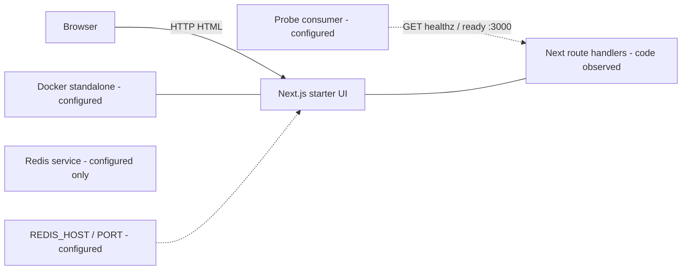
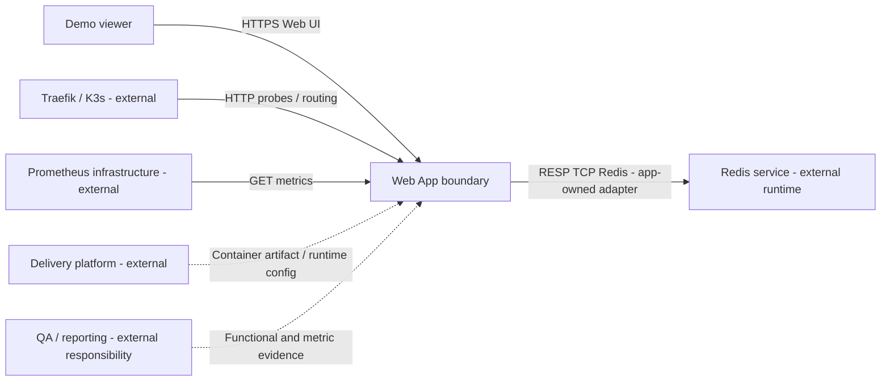
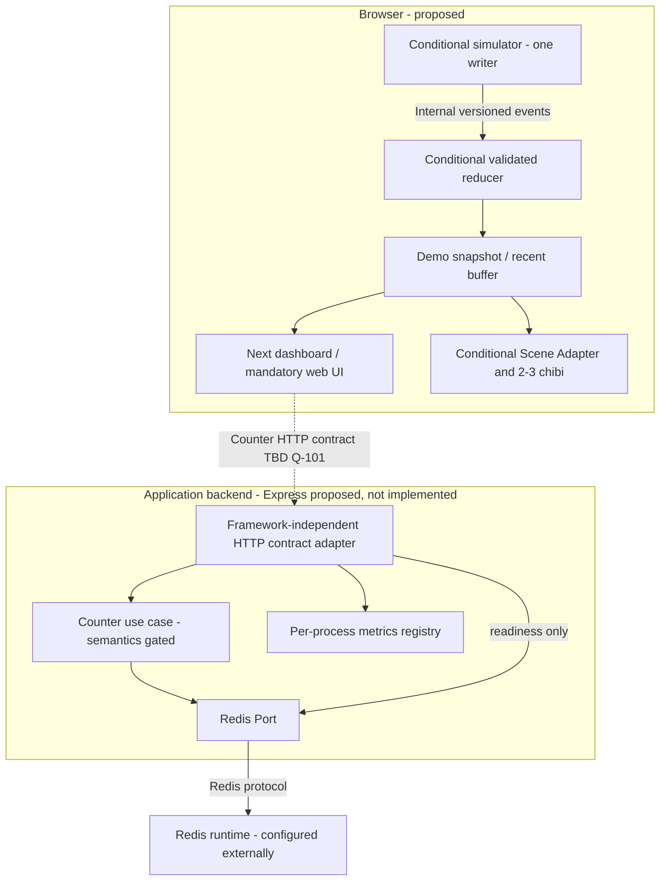
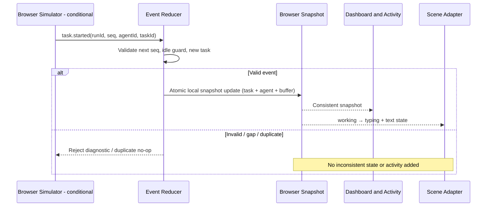
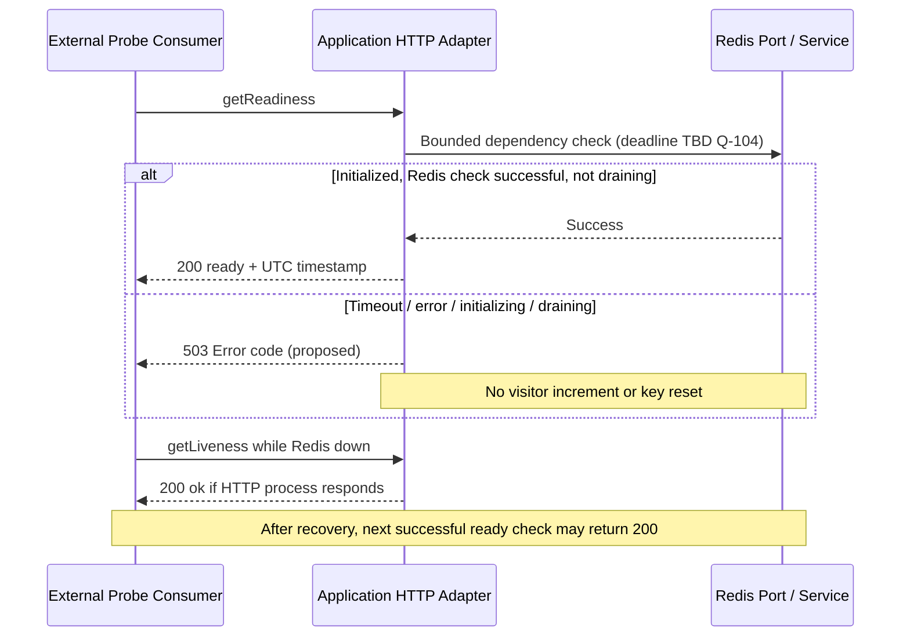
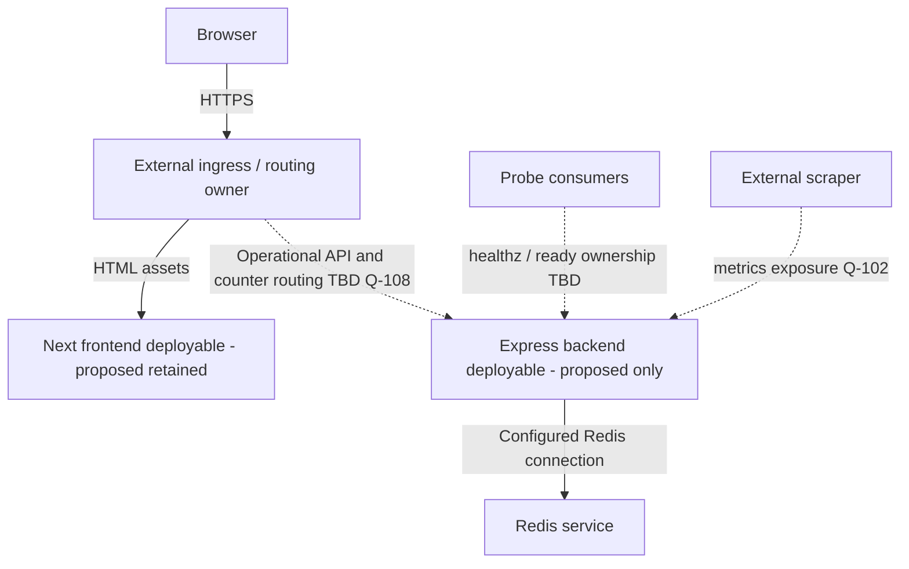

# Architecture — Web App boundary

| Document ID | Version | Status | Date | Owner role | Sources | Upstream |
|---|---|---|---|---|---|---|
| PT-ARCH | 0.1.0 | DRAFT | 2026-11-05 | Web Fullstack Dev / Solution Architect | E-100..E-108, [report](evaluation-report.md) | PT-BRD/PT-FRD/PT-API 0.1.0; Data 0.1.0 reviewed after creation |

Change log 0.1.0: current/configured/proposed tách riêng; conditional scene design dựa trên [reference analysis](07-reference-analysis.md), không source reuse trong bài test.

## Boundary và current evidence

Web App sở hữu UI, application API/domain logic, Redis adapter và application metrics. Platform sở hữu routing, cluster, policy, delivery, scrape infrastructure. QA sở hữu load execution/report; Web cung cấp hành vi và metrics có thể kiểm tra. Không vẽ CI/CD thành product feature.

| Item | State | Evidence / limitation |
|---|---|---|
| Next.js 16.4.3 + React 19.3.0 | Dependency configured; starter page code-observed | app/package.json; app/src/app/page.tsx, chưa install/build/run |
| GET /healthz, /ready | Implemented theo nghĩa code-observed | E-103; không tested; ready không Redis check |
| Docker standalone, port 3000, UID 10001:10001 | Configured | Dockerfile/next.config.ts; chưa build |
| Redis service/env/NetworkPolicy | Configured external | E-104; app chưa client; root kustomization đặt resources trong production-app |
| Express, prom-client, Redis application integration | Planned/intended | README + user; chưa implementation/dependency trong app |
| Three.js, simulator, agent dashboard | Proposed | User candidate extension, chưa code |
| SSE | Optional/deferred | Không thêm connection manager/broker vào current/target candidate |
| Live deployment | Unknown | Không gọi cluster hoặc suy running từ manifests |

README mô tả Redis namespace database và Node 24; inspected kustomization là production-app, Docker Node 26.13.0. Đây là C-101/C-102, integration alignment cần nhóm xác nhận, không sửa manifests. Không nhầm hostname redis-service thành lỗi cross-namespace khi inspected resources cùng namespace.

Không có đường N→R trong current code view vì chưa client.

## Proposed system context

## Component register và proposed component diagram

| Component | Responsibility / FRs | Interface | Data ownership / dependencies | Design disposition |
|---|---|---|---|---|
| Next UI | FR-100/106/109..111; text remains usable if scene init fails | HTML/React client snapshot | Presentation state; no Redis credentials | BUILD UI, ADAPT visual ideas |
| Browser Demo Engine (conditional) | FR-107/108; one writer and reducer | Internal SimEvent → Snapshot | ENT-101..103 transient browser run | BUILD minimal simulator; no server ingestion |
| Scene Adapter (conditional) | FR-109/110; state→poses, dispose lifecycle | Snapshot + agent IDs → ScenePort | Derived render state only | ADAPT chibi/renderer; not workers.js wholesale |
| Application HTTP adapter | FR-102/103/104 | getLiveness/getReadiness/getApplicationMetrics | Transient statuses, per-process registry | Express proposed, Next handlers current |
| Counter use case + Redis Port | FR-101 | HTTP TBD Q-101; internal increment/read | ENT-100 Redis total | BUILD; no ORM/domain framework dependency |
| Metrics registry | FR-104, NFR-105 | Prometheus text; internal request hooks | Process-local series, not Redis business total | BUILD/adopt compatible library later |
| Redis runtime | FR-101/103 | Redis adapter via config | Counter authoritative within explicit loss limits TBD | External configured; no new broker |

Không có agents backend API trong phương án ADR-101. Redis application agent state chỉ là alternative, chưa key plan. HTTP/Data contract trước implementation; không đưa Express response defaults thành canonical schema.

## Core sequence và failure/recovery

Counter success/failure sequence không thể chốt trigger/retry trước Q-101. Data quy định atomic increment và ambiguous timeout; không claim transaction bao gồm network response.

## Deployment và integration contracts — proposed, chưa thay configuration

| Node / environment | Network / config / ownership | Limits / gaps |
|---|---|---|
| Current app container configuration | Next standalone port 3000, non-root; ConfigMap PORT/REDIS_HOST/REDIS_PORT | Backend split không nằm trong Dockerfile/CI hiện tại |
| Proposed frontend + Express backend | Same-origin routing preferred proposal; backend port/origin/container count TBD Q-108 | Platform phải duyệt probe/UI relationship; backend readiness không chứng minh frontend render |
| Redis service | Same namespace theo root kustomization; app kết nối qua adapter, không expose Redis ra browser | Credentials/TLS/persistence policy chưa chốt; secret injection nếu có do Platform |
| Local vs cluster | Local run evidence và live cluster chưa kiểm chứng | Không thiết kế lại K3s/Tailscale/NetworkPolicy |

Config credentials không đưa vào browser bundle/log. Binding port, routing ownership, app shutdown signal và drain deadline cần thống nhất Q-108/Q-104 trước split backend. Đưa Express vào standalone Next image hiện tại mà không đổi packaging là giả định sai; task này chỉ nêu finding.

## NFR realization

| NFR | Control / component | Trade-off / verification | Evidence / gap |
|---|---|---|---|
| NFR-100 | Existing non-root configuration; proposed backend áp dụng cùng nguyên tắc | Build/run kiểm tra writable paths/UID; không giả định image build được | Configured only; backend image TBD Q-108 |
| NFR-101 | HTTP adapter check bounded Redis; drain readiness | PING nhẹ nhưng không chứng minh write permission; fail/restore timing QA | Deadline/check depth TBD Q-104 |
| NFR-102 | Scene Adapter, 2–3 rigs, cap pixel ratio, static merging có kiểm soát | Profile trước bloom/advanced merge; dispose/unmount; chưa nhận FPS reference | Hardware/FPS/memory target TBD Q-104 |
| NFR-103 | Synthetic events; no host file/CLI ports; explicit integration access review | Tránh credential surface; auth feature tương lai không giải quyết metrics exposure | Access/origins TBD Q-102 |
| NFR-104 | Redis atomic increment; explicit missing/timeout behavior; demo transient | Atomic != durable; no persistence claim | Loss/eviction/backup/RPO/RTO TBD Q-103 |
| NFR-105 | Per-process registry; bounded labels; readiness false khi drain | Parser và traffic test; shutdown coordination với Platform | Q-106 metric vocabulary, Q-104 drain |
| NFR-106 | Text status/dashboard ngoài canvas; visual redundant labels | Manual keyboard/accessibility review; optional 2D renderer chưa chọn | Standard/device coverage TBD Q-105 |

## Operations và failure handling

Redis down: counter unavailable, ready 503 proposed, live 200 nếu process còn trả lời, metrics scrape độc lập. Counter timeout sau ghi có thể ambiguous; không auto retry cho đến khi có policy. Mất key/eviction không được tự tuyên bố total=0, xem Data Q-103. Metrics registry lỗi: 503 METRICS_UNAVAILABLE proposed, không phụ thuộc business state. WebGL lỗi: thông báo scene unavailable, UI text giữ nguyên; không ghi failure task vì renderer fail.

Hai replicas configured hiện tại không cho phép tự chọn simulator server timer mỗi pod: sẽ trùng events. ADR-101 giữ một writer/browser; nhiều browser có demo độc lập. Nếu cần shared world, phải quyết định single writer/leader, source of truth, retention, CAS và fan-out trước khi revise contracts. Không thêm Redis Pub/Sub chỉ để chuẩn bị future.

## ADRs và portability

| ADR / status | Problem / alternatives | Proposed choice / reason | Cost / revisit trigger |
|---|---|---|---|
| ADR-100 / proposed | Current Next routes vs separate Express intent | Giữ mô tả current Next; tách Express domain/HTTP/Redis ports trong target conditional | Thêm deployable đòi hỏi Q-108; xem lại nếu muốn backend tiếp tục Next |
| ADR-101 / proposed, A-100 | Browser simulator vs shared server simulator | Browser-only event/reducer cho nhỏ gọn, không cần auth/mutation/SSE | Không shared/persistent agents; xem lại khi nhiều viewers cần cùng state |
| ADR-102 / proposed | Readiness always 200 vs dependency-aware | Init+Redis bounded check+not draining, giữ success body, thêm 503 | Operational behavior thay đổi; cần probe owner duyệt Q-104 |
| ADR-103 / proposed | Copy entire office vs selected visual modules | ADAPT rig/renderer/camera, BUILD state mapper/demo UI; SKIP CLI/account/extra city | React cleanup và licensing audit cần effort; xem [matrix](07-reference-analysis.md) |
| ADR-104 / proposed | Domain state vs process observability coupling | Registry local, không đọc Redis cho scrape; bounded labels, text exposition | Metric set Q-106, process restarts reset counters |

Domain state/event contract không chứa Express request/response hoặc Laravel model classes. Redis Port sở hữu encoding/atomic operation; HTTP adapter serialize schema đúng API; ScenePort nhận domain snapshot thay vì My Office sess/desk fields. Migration kế thừa các seams, không coi chúng đã được implementation.

## Evidence, impacts và validation

E-103/104 phân biệt code/config; E-108 chỉ technical evidence. A-100 proposed; Q-100..108 và contradictions canonical tại report. Chọn shared simulator, SSE hoặc persistence sẽ tác động FR-107/108/111, API coverage, Data ENT-101..103 và migration; cần revision đồng bộ trước accepted baseline.

| ID | Check / severity | Locations / expected vs observed | Impact | Correction / owner | Result |
|---|---|---|---|---|---|
| VAL-105 | Architecture consistency / major | PT-ARCH/API/Data 0.1.0: browser transient simulation, no stream/persisted history | Không promise replay từ ephemeral state | Giữ ADR-101; revisit có kiểm soát / Web owner | PASS design consistency |
| VAL-106 | Integration / blocker | E-104 current standalone vs proposed Express split Q-108 | Target chưa deployable-ready | Chốt topology/probes/runtime / Web+Platform | BLOCKED readiness |

Đã kiểm tra mapping tất cả FR/NFR và Mermaid text. Diagram rendering, runtime, resource fit và routing không được xác nhận bởi việc đọc source; xem report cho executed checks.
