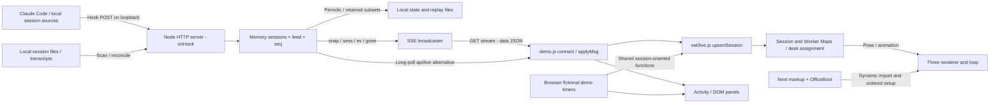

# Reference analysis — My Office

| Document ID | Version | Status | Date | Owner role | Sources | Upstream |
|---|---|---|---|---|---|---|
| PT-REF | 0.1.0 | DRAFT | 2026-11-05 | Solution Architect / Documentation QA | E-108: khanh020905/my-office, commit `77fdd1371ea1f3a78bd905880b5681deec3b7a45` | User research brief; PT-BRD scope 0.1.0 |

Change log 0.1.0: source-only technical review qua GitHub connector. Không clone/copy source vào target, không install dependencies, chạy scripts, hooks, service hoặc demo của reference. Diagrams là diễn giải từ code, không runtime traces.

## Evidence protocol và source index

Tất cả links dưới đây pin cùng commit. “Verified” nghĩa file đã được đọc, không có nghĩa feature đã được chạy. Source-stated mô tả của tác giả được phân biệt với inspected implementation. Repository default main được resolve qua commits/main trước các reads sâu; package/LICENSE ban đầu đọc main, sau đó fetch lại tại pinned commit và xác nhận content khớp.

| Ref | File / source | Nội dung đã kiểm tra |
|---|---|---|
| R-100 | [package.json](https://github.com/khanh020905/my-office/blob/77fdd1371ea1f3a78bd905880b5681deec3b7a45/package.json) | Next 16.4.3, React 19.2.4, Three 0.160.0; custom server scripts; không Express dependency |
| R-101 | [docs/ARCHITECTURE.md](https://github.com/khanh020905/my-office/blob/77fdd1371ea1f3a78bd905880b5681deec3b7a45/docs/ARCHITECTURE.md) | Source-stated module topology, markup DOM contract, state/replay lifecycle; đối chiếu code dưới |
| R-102 | [OfficeBoot.tsx](https://github.com/khanh020905/my-office/blob/77fdd1371ea1f3a78bd905880b5681deec3b7a45/src/components/OfficeBoot.tsx#L1) và [main.js](https://github.com/khanh020905/my-office/blob/77fdd1371ea1f3a78bd905880b5681deec3b7a45/src/office/main.js) | Client effect, dynamic import, setup order và không teardown trong Boot |
| R-103 | [server/index.mjs state](https://github.com/khanh020905/my-office/blob/77fdd1371ea1f3a78bd905880b5681deec3b7a45/server/index.mjs#L243) | sessions Maps, feed/seq và state.json save interval |
| R-104 | [onHook](https://github.com/khanh020905/my-office/blob/77fdd1371ea1f3a78bd905880b5681deec3b7a45/server/index.mjs#L1009) và [/event](https://github.com/khanh020905/my-office/blob/77fdd1371ea1f3a78bd905880b5681deec3b7a45/server/index.mjs#L2523) | Hook session identity, state changes, loopback intake |
| R-105 | [SSE broadcaster](https://github.com/khanh020905/my-office/blob/77fdd1371ea1f3a78bd905880b5681deec3b7a45/server/index.mjs#L512), [stream handler](https://github.com/khanh020905/my-office/blob/77fdd1371ea1f3a78bd905880b5681deec3b7a45/server/index.mjs#L3125) | SSE data frames, heartbeat, snapshot; separate long-poll backlog |
| R-106 | [demo/demo.js](https://github.com/khanh020905/my-office/blob/77fdd1371ea1f3a78bd905880b5681deec3b7a45/src/office/demo/demo.js#L194) | Fictional sessions, timers, applyMsg và EventSource/long-poll transport |
| R-107 | [net/live.js](https://github.com/khanh020905/my-office/blob/77fdd1371ea1f3a78bd905880b5681deec3b7a45/src/office/net/live.js#L91) và [people/workers.js](https://github.com/khanh020905/my-office/blob/77fdd1371ea1f3a78bd905880b5681deec3b7a45/src/office/people/workers.js#L71) | Session/worker/subagent Maps, desk assignment, rest/wait/work animation mapping |
| R-108 | [people/chibi-rig.js](https://github.com/khanh020905/my-office/blob/77fdd1371ea1f3a78bd905880b5681deec3b7a45/src/office/people/chibi-rig.js#L1) | Procedural Three geometry, makeChibi, pose/IK, merge/disposal functions |
| R-109 | [scene/renderer.js](https://github.com/khanh020905/my-office/blob/77fdd1371ea1f3a78bd905880b5681deec3b7a45/src/office/scene/renderer.js#L1) | WebGL, cameras, controls, CSS labels, postprocessing |
| R-110 | [core/optimize.js](https://github.com/khanh020905/my-office/blob/77fdd1371ea1f3a78bd905880b5681deec3b7a45/src/office/core/optimize.js) và [core/loop.js](https://github.com/khanh020905/my-office/blob/77fdd1371ea1f3a78bd905880b5681deec3b7a45/src/office/core/loop.js) | Mesh merging imports/logic; loop và many-world dependencies, adaptive budgeting |
| R-111 | [ui/lite.js](https://github.com/khanh020905/my-office/blob/77fdd1371ea1f3a78bd905880b5681deec3b7a45/src/office/ui/lite.js) | Session-list 2D alternative, filters và world boot dependency |
| R-112 | [hooks/send.mjs](https://github.com/khanh020905/my-office/blob/77fdd1371ea1f3a78bd905880b5681deec3b7a45/hooks/send.mjs) | stdin payload và POST hooks transport; không chạy |
| R-113 | [LICENSE](https://github.com/khanh020905/my-office/blob/77fdd1371ea1f3a78bd905880b5681deec3b7a45/LICENSE) | MIT notice, copyright 2026 khanh020905 |
| R-114 | [brands/README.md](https://github.com/khanh020905/my-office/blob/77fdd1371ea1f3a78bd905880b5681deec3b7a45/public/assets/brands/README.md), [vehicles/README.md](https://github.com/khanh020905/my-office/blob/77fdd1371ea1f3a78bd905880b5681deec3b7a45/public/assets/vehicles/README.md), [qrcode.min.js](https://github.com/khanh020905/my-office/blob/77fdd1371ea1f3a78bd905880b5681deec3b7a45/public/assets/vendor/qrcode.min.js) | Asset provenance notes, trademark distinction, vendored JS inventory |

## Repository architecture — verified findings

My Office có hai phần: Next App Router page/React markup và custom Node ESM HTTP server dùng `node:http`, không phải Express. App page/markup organization được docs của tác giả mô tả; `OfficeBoot.tsx` xác nhận client effect dynamic import plain JS engine. `main.js` nhập nhiều modules theo setup order, từ scene/furniture/people tới UI/net/render loop. Các modules dùng shared state và DOM IDs; đây không phải toàn bộ scene declarative React.

`server/index.mjs` giữ `sessions`, `sidToKey` trong memory; session key dựa PID/session ID (R-103). Feed/stats/seq có snapshot file riêng; không thấy Redis trong dependency manifest hoặc server imports đã đọc. Điều này không chứng minh tất cả modules đều không dùng bất kỳ store nào; kết luận phù hợp là reference architecture chủ yếu memory + local files theo R-101/R-103, không phải Redis state contract có thể áp dụng sẵn.

Hook handler `onHook` đọc hook_event_name/session_id, phân loại tool events. UserPromptSubmit/PreToolUse chuyển `work`, PermissionRequest chuyển `wait`, Stop/StopFailure về `rest`. Fail tool event không đồng nghĩa session giữ `failed`. Target bốn states **không tương đương** reference `work/wait/rest`; không map `rest` mặc định thành completed hoặc `wait` thành failed.

Backend có file/session scans, usage, git, system và account services rộng hơn bài toán target. Các module account/task/undo/vault được docs R-101 mô tả; imports và CLI primitives trong server xác nhận surface tồn tại, chưa audit toàn bộ implementation từng service.

## Component và data flow diagram

Luồng live: intake nhận hook → cập nhật session/feed → broadcast compact envelope `{k,...}` → EventSource nhận `data` JSON → `applyMsg` xử lý snap/sess/ev/gone → upsert session, update worker/desk và panels → loop render. Điểm dễ bỏ sót: `net/live.js` quản lý session/desk, còn `connect()`/`applyMsg()` thực tế nằm trong `demo/demo.js` (R-106), nên tên thư mục không thể dùng thay source reading.

SSE sender viết data frames không có `id:`/named `event:`; stream gửi initial snapshot và heartbeat comment 20 giây, close cleanup. Long-poll `/api/live?since=` có backlog 400 messages và resnapshot khi lệch cursor (R-105). Local replay log là subsystem khác, file retention 7 ngày được code R-105 nêu. Không đồng nhất event numeric ID với SSE Last-Event-ID; không suy SSE có replay/durability chỉ vì có file replay. Những con số này chỉ mô tả reference, không đưa vào target requirements.

Demo tạo fictional projects/sessions, chuyển work/wait/rest bằng timers và dùng cùng UI/session-oriented functions. Có cả fake Mac/usage/todos/account views nên copy demo.js sẽ kéo theo nhiều feature ngoài scope. Không có lý do business để target mô phỏng những data đó.

## Reuse / Adapt / Build / Skip matrix — proposals, chưa thực hiện reuse

Effort là relative S/M/L theo dependency surface, không phải estimate ngày được cam kết. Priority P0 mandatory, P1 nếu extension được chọn, P2 optional, P3 ngoài MVP. REUSE vẫn phải license/security review; không có code nào được copy trong bài test.

| Component | Class | Evidence / reason | Dependencies / adapter | Effort / risk | Priority |
|---|---|---|---|---|---|
| Pure deterministic palette/hash helpers | REUSE candidate | workers.js helper không cần session lifecycle khi tách độc lập | Extract pure utility, giữ MIT notice nếu copy sau | S / low; không import cả workers module | P1 |
| Procedural chibi rig + basic poses | ADAPT | makeChibi/pose/IK phù hợp không cần external GLB model | Three/addons, i18n labels, ownership/dispose; slim rig adapter | M / geometry/material cost, cleanup, license | P1 |
| Office furniture subset | ADAPT | World modules tạo office nhưng nhiều room/props/life dependencies | Chỉ desk/floor/light cho 2–3 agents; ScenePort | M / coupling tới layout globals | P1 |
| Renderer / camera / controls | ADAPT | Orthographic camera + OrbitControls phù hợp quan sát office | Client-only setup, canvas ref, resize, unmount cleanup | M / CSS labels/postprocessing/heavy pipeline | P1 |
| Worker/session state mapping | BUILD | work/wait/rest, desk, subs, prompts khác target model | Target Agent→RenderState adapter; không nhận raw session | M / sai state nếu map máy móc | P1 |
| Simulator | BUILD, tham khảo timers | Reference simulates cả Mac/accounts/todos | Small scenario + validator/reducer, one writer/browser | S–M / duplicate timers, task consistency | P1 |
| Activity panel / dashboard | BUILD | DOM/session coupling cao và nhiều controls ngoài scope | React snapshot projection, bounded recent panel | M / React vs imperative DOM ownership | P1 |
| Redis visitor + state policy | BUILD | Reference không cung cấp Redis visitor contract | Counter use case, Redis Port, semantics Q-101/103 | M / correctness, failure/recovery | P0 |
| Realtime transport | SKIP trong candidate MVP; ADAPT concept nếu chọn | Source có SSE và long-poll nhưng target SSE optional | Event envelope mới, access, proxy, reconnect semantics riêng | M–L / fan-out/cursor/retention | P2 |
| Static mesh merge / frame budget / disposal | ADAPT theo profiling | Source optimize/loop/rig có controls thực tế | Remove world-specific dependencies; dynamic parts không merge | M / freezing animated geometry, overoptimization | P1 selective |
| Lite mode / history / filters | SKIP trong candidate MVP | Có reference nhưng user Optional | Nếu chọn cần behavior và retention contract mới | M / scope/time | P2 |
| CLI execution, hooks, vault, account switching, undo, real agents | SKIP | Local privileged workflow khác web monitor mô phỏng | Không import backend/bin/hooks/platform modules | L / secrets, host write/exec, logs | P3 |
| City, shops, vehicles, QR/mobile/PIN, seasonal activities | SKIP | Không hỗ trợ mandatory hoặc 2–3-agent office tối thiểu | Loại external brand/model assets khỏi candidate | L / GPU/assets/licensing surface | P3 |

## Compatibility và coupling assessment

| Technology | Finding | Target interface / unresolved risk |
|---|---|---|
| Next.js | Reference và target manifests cùng Next 16.4.3; React versions khác; chưa thử compatibility | Client-only Scene host; no SSR DOM side effects; mount/dispose controls; không copy Boot “never torn down” vào route remount |
| Express | Reference dùng node:http custom router và hosts Next; target chưa Express | Build independent HTTP adapter từ own OpenAPI; không gọi reference server là Express baseline |
| Redis | Reference memory/local-file semantics không đảm bảo multi-replica shared world | Counter adapter riêng; agents ở browser proposal; shared Redis state cần quyết định mới |
| Three.js | Reference pins 0.160.0, target chưa dependency | Review version/addons API khi chọn; ScenePort giảm coupling; không assume upgrade an toàn |
| SSE | Reference data/session messages chứa nhiều local-domain fields | Optional gate; không adopt /stream, token query hoặc compact k envelope làm target contract |

Proposed interfaces: DomainSnapshot chứa agent/task IDs và states; ScenePort quản lý mount/update/resize/dispose; SimEvent validator/reducer độc lập renderer; CounterPort tách Redis khỏi transport. Chúng thuộc target design ADR-101/103, không phải interfaces đã có trong My Office.

## Performance evidence và giới hạn

R-108 dùng procedural geometry và merge rig; R-110 merge geometries để giảm draw calls nhưng phụ thuộc world state và giữ moving parts riêng. Renderer có postprocessing, bloom, PMREM, nhiều camera; loop kéo theo nhiều life/props systems. R-101 mô tả frame budgets 60/40/10/5 FPS và memory commentary; đây là claims/source configuration, không benchmark đã tái đo. Candidate MVP không cần bloom/city/full loop; giới hạn 2–3 rigs và đo thực tế trước tối ưu sâu.

Dispose geometry/material/texture và stop timers/animation frames là lifecycle requirement cần thiết khi adapt. Reference Boot gọi start once, không teardown trong effect; đó là integration risk khi Next route remount/hot reload, chưa là lỗi được tái hiện.

## Security và licensing findings

| Finding | Evidence / verification | Consequence / required follow-up |
|---|---|---|
| Repository source MIT | LICENSE R-113 đã đọc; copyright 2026 khanh020905 | Có điều khoản giữ copyright/permission notice khi phân phối bản sao/phần đáng kể; không xóa notice khi adapt. Chưa có reuse thực tế |
| MIT không bao phủ blanket mọi third-party asset | R-114 brands notes ghi PD-textlogo/CC0 source claims và vẫn trademark; vehicles notes ghi Kenney Car Kit 3.1 CC0 | Đây là provenance do tác giả nêu, chưa độc lập verify từng upstream asset. Candidate skip brands/cars nên không kéo vào MVP |
| Vendored QR/fonts/dependencies cần inventory riêng | public/assets/vendor/qrcode.min.js có file; nguồn/license đầy đủ chưa được xác minh ở lượt review này; Boot dùng font faces | Không gán MIT của repo cho vendor/font. Trước reuse phải kiểm dependency notices/asset licenses theo file; QR không cần candidate |
| Local privileged surface lớn | server imports fs/child_process/account/undo modules; R-101 mô tả vault, credential/account handling, task execution | Không expose local APIs vào public Web App; không mount home/credentials hoặc chạy reference CLI |
| Reference có controls nhưng không là security certification | Loopback `/event`; stream context local/nonlocal; host/PIN/token controls mô tả trong source/docs | Không copy trust model local workstation sang ingress; token query có thể lọt URL logs nếu adopt, nên target không adopt |
| Payload semantics không đáp ứng target validation mặc định | `/event` phản hồi 200 trước async hook processing; malformed JSON bị ignore; reference cho phép large hook payload | Không coi 200 intake là task accepted; own contract phải quyết định validation/mutation nếu future real ingestion |
| Sensitive logs/transcripts và credentials | R-101/R-103 có local files, replay, account-related imports; redactor module hiện diện | Redaction existence không chứng minh mọi secret đã che; synthetic-only target không cần thu prompts/paths/tokens |

Đây là source/provenance review có giới hạn, không xác nhận bảo mật toàn repo hoặc quyền mọi asset. Chưa audit transitive dependency licenses/vulnerabilities và chưa độc lập đối chiếu các Commons/Kenney/vendor/font upstream. Khi chọn một asset/module, kiểm đúng license artifact và notices trước implementation.

## MVP recommendation và use as design evidence

Ưu tiên mandatory trước. Nếu Q-100 chọn extension: BUILD browser simulator/reducer/dashboard/recent panel; ADAPT slim chibi, desk scene, orthographic camera và basic animation; dùng state mapper riêng. Skip local server modules, full office lifecycle, city và real-session integrations. SSE, lite/history/filtering giữ optional, không “được chọn” chỉ vì reference có.

BRD chỉ dùng research để đánh giá feasibility/time/scope. FRD chỉ đặc tả user-proposed extension conditional. API giữ own operations, không adopt /event hay /stream. Architecture ghi ADAPT/BUILD/SKIP và boundaries. Data dùng Agent/Task/Event riêng với UTC/sequence riêng, không sao chép sess/ts/PID/cwd. Migration chỉ chuyển interfaces/backend đã có baseline sau này; reference server không thay thế source Express target còn thiếu.

## Facts, assumptions, decisions, questions và validation

Facts R-100..114 có source references và inspection date ở control. A-100 là target browser-only feasibility assumption, không kết luận reference requirement. ADR-103 proposed. Q-100 scope selection, Q-107 simulator limits và asset-specific audit trước reuse còn mở; owner Web. Không có decision implementation được phê duyệt bởi report này.

| ID | Check / severity | Locations / expected vs observed | Impact | Correction / owner | Result |
|---|---|---|---|---|---|
| VAL-115 | Source architecture / major | R-102..110 đối chiếu R-101; transport connect thực ở demo.js | Không suy từ filename/README | Pin ref và map cụ thể / reviewer | PASS static source analysis |
| VAL-116 | Asset reuse clearance / major | R-113/114: code MIT verified, asset claims chưa independent verification | Không blanket reuse-approved | Inventory chosen assets + upstream review / Web owner | BLOCKED actual asset reuse clearance |

Unchecked: chạy demo/CLI, hardware profiling, full security audit, transitive dependency/asset clearance, target integration proof. Không thực hiện những việc đó trong docs-only test.
