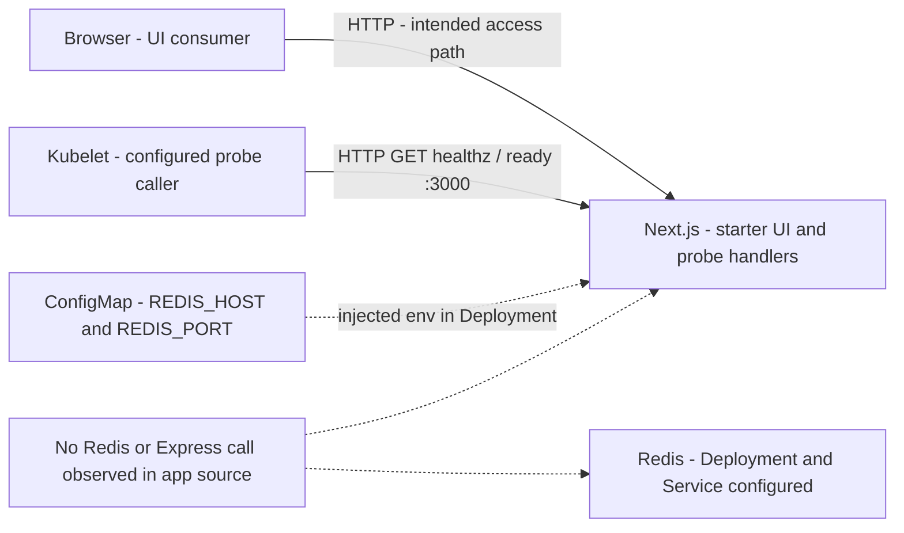
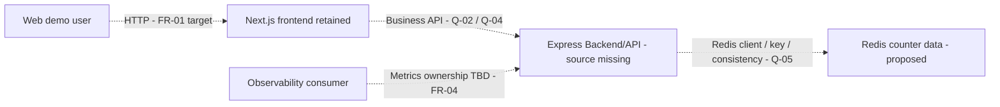
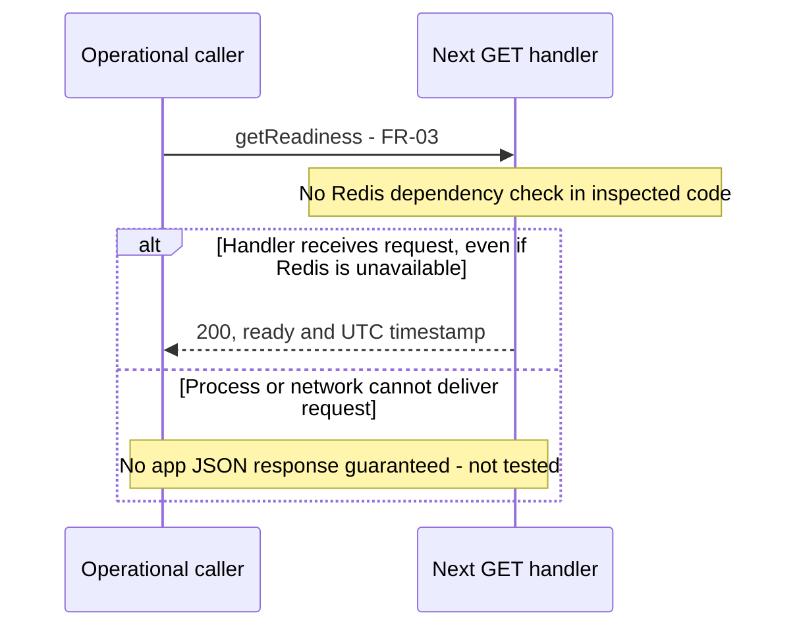
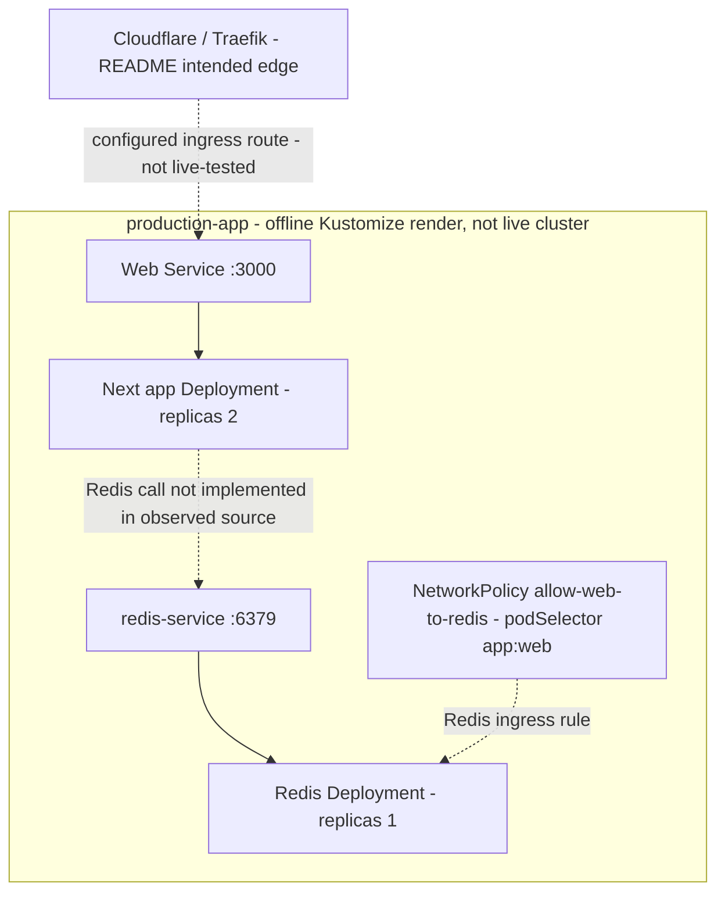

# Architecture thử nghiệm — Web demo NT548

> SANDBOX. Áp dụng `architecture-design`; code/config-observed khác deployed. Không đổi application/infra.

| Document ID | Version | Status | Date | Owner role | Sources | Upstream versions |
|---|---|---|---|---|---|---|
| TEST-ARCH | 0.1.0 | draft | 2026-11-05 | Web Dev + Platform; approval Q-01 | E-01..E-11; offline Kustomize render | TEST-BRD, TEST-FRD, TEST-API đều 0.1.0 |

Change log 0.1.0: tách sơ đồ current/proposed, lập CTL-01..05 và ADR-01/02. Data chưa tồn tại lúc bước này bắt đầu; so sánh Data được follow-up sau bước 5, không tự chọn TTL/key.

## Context và boundaries

Web demo hỗ trợ BR-01/02; BR-03 thuộc hoạt động thu thập minh chứng. README/WBS là ý định nhóm; source là snapshot được pin; không kiểm chứng K3s/ArgoCD/Grafana đang hoạt động. Hybrid topology Cloudflare → Traefik/K3s qua Tailscale được README mô tả, không phải live state quan sát được ở lượt này.

Boundary quan trọng: browser/public edge, HTTP operational handlers, namespace workloads, Redis data service. Không có source identity/auth policy đầy đủ; pod labels không phải quyền nghiệp vụ. Không đưa AI agents, SSE, broker hoặc Laravel runtime vào kiến trúc current.

## Components và interfaces

| Component | Responsibility / FR | Interface | Data ownership | Dependencies / boundary | State / evidence |
|---|---|---|---|---|---|
| Browser | Hiển thị web, FR-01 dự kiến | HTTP tới Next, business data interface TBD | Không xác định storage phía browser | Public edge/access Q-04 | UI starter source E-04, chưa counter |
| Next App Router | UI và current probes FR-02/03 | getHealth, getReadiness; HTTP3000 cấu hình | ENT-01/02 transient process reports | Không thấy gọi Redis/Express trong source | Code/config-observed E-03..E-08 |
| Express Backend/API | Intended backend từ README, owner boundary Q-04 | Business operations/ports TBD; không gán probes hiện có sang Express | Counter ownership TBD | Redis integration intent | Source-stated planned; không thấy backend code |
| Redis | Counter store dự kiến, FR-01 | Service redis-service TCP6379 theo config | ENT-03 candidate; key/lifecycle TBD | Root render namespace production-app | Config-observed E-08..E-10; client link missing |
| Kubelet probes | Kiểm tra handlers Next FR-02/03 | HTTP GET health/ready | Không lưu report theo app code | Web container port3000 | Config-observed E-08 |
| Prometheus/Grafana | Observability theo README, FR-04 | /metrics intended, definition/owner TBD | Retention/labels TBD Q-07 | Scrape wiring/live state chưa kiểm tra | Source-stated, app metrics chưa thấy code |
| Delivery edge | GitHub Actions/GHCR/ArgoCD, Cloudflare/Traefik | Theo README, ngoài contract slice | Deployment config | Repo main/namespace | Chỉ source/config; chưa pipeline/cluster test |

## Current code/config view

Không có cạnh Next→Redis như một kết nối đã chạy. Env injection không chứng minh app đọc env. Dấu đứt mô tả cấu hình/gap, không biểu diễn data flow đã được kiểm thử.

## Proposed role view, không phải approved target

Vai trò Express từ README có thể đồng tồn tại với Next frontend. Chưa chứng minh boundary/protocol/location backend, nên ADR-02 là đề xuất cách diễn đạt, không là quyết định được chấp nhận. Vị trí metrics/probes target còn Q-03/Q-04; sơ đồ không chuyển các probe đang ở Next sang Express.

## Probe sequence và failure path

Health tương tự nhưng dùng process.uptime theo API/RULE-02. Không mô hình hóa startup→ready persisted state; hai reports là transient. Counter success/failure sequence chi tiết BLOCKED Q-02/Q-05: chưa có API hoặc client code để mô tả là current. Recovery dữ liệu không được suy từ việc redeploy container.

## Deployment/config view

Sơ đồ Web Service và Redis Service chỉ là object routing cấu hình, không là kết nối đã đo. [Offline render](../kustomize-render.yaml) được tạo bằng `kubectl kustomize k8s-manifests`, không liên hệ API server, không apply. Root transformer cho Web/Redis/NetworkPolicy cùng namespace `production-app`; rendered output xác nhận C-04. Không có namespace `database` chỉ vì tên folder. Policy dùng podSelector app:web trong namespace; không khai namespaceSelector trong file được đọc. CNI enforcement và access allow/deny còn chưa test.

Configuration: Web lấy PORT/REDIS_HOST/REDIS_PORT từ ConfigMap; Next standalone Dockerfile khai UID/GID 10001, node image string 26.13.0. Redis không có volume/PVC trong manifest đã đọc; không cam kết durability thực tế. Secrets/auth policy ngoài slice, không chép TLS secret hoặc suy public exposure được duyệt. ArgoCD file trỏ main/k8s-manifests; README directory recurse không khớp cấu hình quan sát (C-06); chưa truy vấn live ArgoCD.

## NFR realization

| NFR / source version | Control | Component / realization | Trade-off / limits | Verification / evidence | Gap |
|---|---|---|---|---|---|
| NFR-01 / FRD0.1.0 | CTL-01 | UID/GID10001, non-root/drop ALL, seccomp trong config Web | Config không chứng minh actual UID/PSA; readOnlyRootFilesystem:false không là immutable filesystem | E-07/E-08; runtime id/security verification chưa chạy | BLOCKED runtime, config PASS |
| NFR-02 / FRD0.1.0 | CTL-02 | Redis là store intended; lifecycle/consistency Q-02/Q-05 | Chưa client/volume, không hứa exactly-once hoặc durable | Data ENT-03 gap; concurrent/restart/recovery tests sau quyết định | BLOCKED, không có target đủ nguồn |
| NFR-03 / FRD0.1.0 | CTL-04 | Metrics/scrape + QA load intended | Cardinality/limits/load window và payload chưa chốt | E-01/E-02; load/scrape evidence thiếu | BLOCKED Q-04/Q-07 |
| NFR-04 / FRD0.1.0 | CTL-05 | NetworkPolicy + namespace/label selectors configured | Source intended split-namespace khác render; labels không tự chứng minh deny mọi actor | E-10 + offline render; live allow/deny tests chưa chạy | FAIL về README/config agreement; enforcement BLOCKED |

CTL-03 là probe wiring HTTP→Next cho FR-02/03, không tự đáp ứng NFR-02 hoặc chứng minh Redis-ready. Full NFR realization không PASS chỉ vì bảng có đủ NFR IDs.

## Operations, failure và recovery

| Concern | Detection / semantics | Recovery / response | Evidence owner / links |
|---|---|---|---|
| Redis unavailable | Probes Next hiện không phát hiện dependency failure | Counter fallback/retry/fail policy TBD Q-02/Q-03; không tự trả 0 hoặc 503 | Web/Platform; FR-01/03, ENT-03 |
| Web process/network failure | Khi request không tới handler, không bảo đảm JSON | Deployment có probes; restart/routing thực tế chưa được kiểm chứng | Platform/QA; FR-02/03 |
| Redis pod restart/data loss | Config không chứng minh persistence | Không có recovery/restore procedure đã xác thực; RPO/RTO TBD | Web/Platform; NFR-02 |
| Metrics missing | App metrics implementation thiếu trong source | Không đưa missing sample thành zero; target Q-07 | QA/Observability; FR-04/NFR-03 |
| Drain/rollout/scale | Web replicas2/limits/probes configured | Không suy zero downtime, graceful drain hoặc global count accuracy | Platform; tests cần runtime |

## Decisions và portability

| ADR ID / status | Problem / constraints | Alternatives | Proposed choice / rationale | Cost / trade-off | Revisit trigger / impacts |
|---|---|---|---|---|---|
| ADR-01 / proposed | Test skills bằng scope có nguồn, không biến thành project implementation | Full BA baseline ngay; hoặc giới hạn smoke slice | Giữ sandbox counter/probes/metrics; đủ phân biệt evidence/gaps | Chưa bao phủ toàn đồ án; không thể nghiệm thu sản phẩm từ smoke | Sau người dùng review; BRD/FRD/API/Data/Migration 0.1.0 |
| ADR-02 / proposed | README nêu Express, WBS/source nêu Next; backend chưa có code | Assume Next replaces Express; invent full split services; hoặc giữ roles intended và gaps | Giữ Next frontend/probes observed, Express backend intended, Redis intended store; không chọn topology cuối | Cần source backend, access/port ownership Q-04; chưa target baseline | Khi có Express source; API/Data/FRD và migration compatibility review |

Seams cho replacement tương lai là contracts và domain/storage boundaries **được đề xuất**, chưa có domain layer hoặc repository class để kiểm chứng. Không gọi chuyển Next UI sang Laravel là migration Express. Không chốt target framework trong Architecture.

Evidence/A/Q và risks xem [registry](../evidence-register.md). Proposed design có thể thay đổi theo Q-02..Q-07; phải sửa đúng canonical FRD/API/Data trước khi rebaseline. Không áp dụng thay đổi README/WBS hoặc infrastructure ở lượt này.

## Validation

Follow-up QA trong draft 0.1.0: thêm heading Validation tường minh để bảng findings dễ tìm; nội dung kỹ thuật giữ nguyên. Revision hash được ghi trong execution log.

| Finding | Check / severity | Locations + versions / IDs | Expected vs observed | Impact | Correction / owner | Result |
|---|---|---|---|---|---|---|
| VAL-09 | Planned/current separation / major | Architecture0.1.0, ADR-02, E-03..E-11 | Current Next + config Redis, missing backend rõ ràng | Không giả implementation | Web Dev cung cấp Q-04 | PASS về phân loại |
| VAL-10 | NFR realization / major | NFR-01..04, CTL-01..05 | Có controls/gaps và verification, không có runtime proof | Chưa baseline-ready | Resolve Q-03/Q-05/Q-07 + QA evidence | BLOCKED |
| VAL-11 | Namespace agreement / major | C-04, E-01/E-10, offline render | README database vs rendered production-app | Mô tả trust boundary sai | Documentation/Platform, sau review | FAIL ở nguồn; smoke giữ contradiction |
| VAL-12 | API/Data agreement / major | Architecture/API/Data0.1.0 | Transient probes đồng nhất; Redis counter không được fabricate | Chưa full data flow | Resolve Q-02/Q-05 | PASS probe slice; BLOCKED counter |
